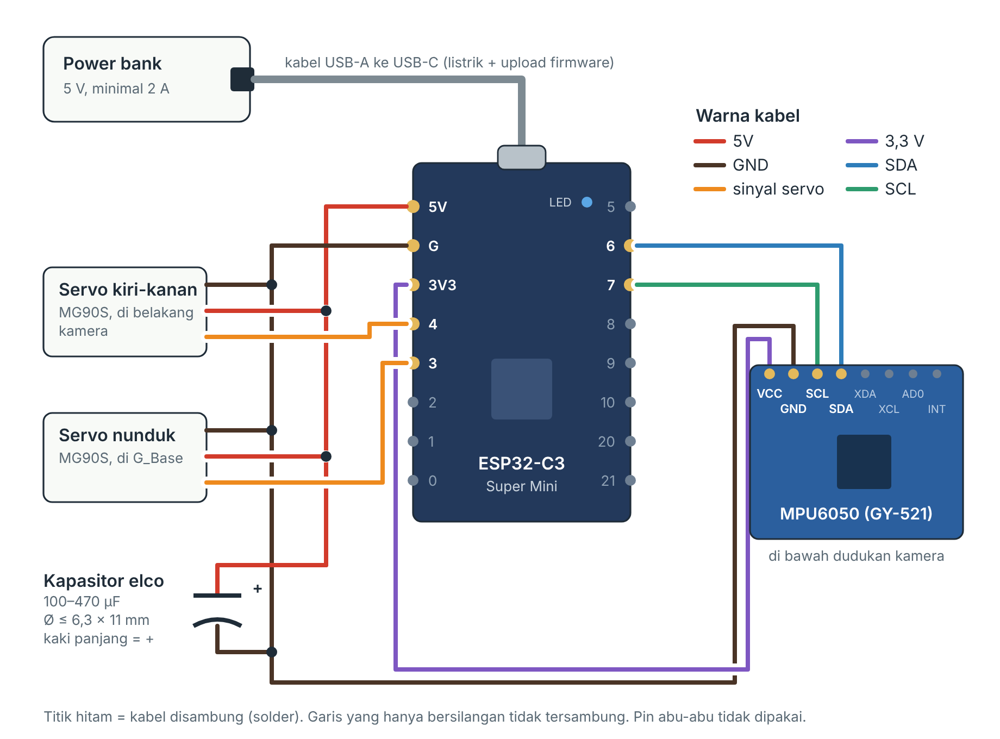

# D435 belt gimbal: build guide

[Bahasa Indonesia](PANDUAN.md) | **English**

The STL files are in `stl`, the full model is `fusion/D435_gimbal.f3d`, the firmware is in `firmware` and the control app is in `docs`. The app is also built into the firmware and opens in a browser.

Terms used in this guide (and their names in the app, which is in Indonesian):
- **Pitch** (*sudut atas-bawah*): how far the camera looks below the horizon. Default 35°.
- **Roll** (*sudut kanan-kiri*): the camera tilting left or right. The target is 0°, a level horizon.
- The **pitch servo** (*servo putar atas-bawah*) sits in the left block of G_Base; the **roll servo** (*servo putar kanan-kiri*) sits in the frame, behind the camera.

## Design principles
- **Every cable is laid in place, then covered.** No cable has to be threaded through a closed hole.
  - The pitch servo cable goes into the channel on top of the plate.
  - The roll servo and IMU cables are laid into the slot of the right pivot tube, then covered by G_PivotCap.
  - All cables enter the ESP32 box through a side slot, then G_EspCover closes it.
- **The electronics can be soldered first**, for example to test them on the bench before the prints arrive. When the prints arrive, the wired servos, IMU and ESP32 are moved in and their cables laid in the channels. Nothing has to be unsoldered.
- **Every cover slides in the direction of its cables** or is open on the cable side, so no cover catches a cable. This was checked in Fusion.

## Shopping list
- 2× MG90S **180°** servo (metal gear). The horns and small screws come in the box. Do not buy the 360° (continuous) version: it cannot hold an angle.
- 1× MPU6050 (GY-521 module, about 21 × 16 mm, two M3 holes).
- 1× ESP32-C3 Super Mini.
- 1× electrolytic capacitor **100–470 µF**, any voltage ≥ 6.3 V, body at most **Ø6.3 × 11 mm** so it fits in the ESP32 box. A good fit: 100 µF 25 V. 470 µF 50 V or 1000 µF parts are usually too big.
- **No extra USB-C module and no resistors.** The power cable plugs straight into the ESP32-C3's own USB-C port.
- **Power bank** 5 V ≥ 2 A and a **USB-A to USB-C** cable. Pick one with a low-current mode so it does not switch itself off.
- The USB-C plug of the power cable must be at most 14 × 8 mm (a normal cable, about 12 × 7 mm, fits).
- A thin, flexible USB-C cable for the D435 (Ø4–5 mm).
- M2 self-tapping screws: **2× M2 × 6** (pitch servo horn) and **2× M2 × 4** (roll servo horn, no longer).
- Wire for the IMU: **20 cm female-male jumper wires** (plugs cut off) or stranded 28 AWG silicone wire in four colours. Do not use solid wire: the IMU cable flexes at a moving joint all the time.
- Heat shrink and a little petroleum jelly or silicone grease for the pivot.
- Optional: 2 cable ties up to 4.8 mm wide.

## Printed parts (every file is already in print orientation)

Plate layout and print order are in `stl/RENCANA_CETAK.md`.

| File | Qty | Notes |
|---|---|---|
| G_Base | 1 | Belt clip, pitch servo mount, right pivot bearing and ESP32 box |
| G_PitchFrame | 1 | Roll servo frame, with a hollow pivot tube on the right |
| G_PivotCap | 1 | Cap of the right pivot bearing (slides in and covers the cables in the tube) |
| G_CamTray | 1 | Camera tray, clamp and the IMU pocket underneath |
| G_ImuLid | 1 | Sliding lid of the IMU pocket |
| G_ThumbScrew | 1 | 1/4" bolt into the camera's tripod hole |
| G_ClampScrew | 1 | Clamp tightening bolt |
| G_ClampJaw | 1 | Clamp jaw |
| G_Nut_M6 | 1 | Clamp nut |
| G_EspCover | 1 | ESP32 box cover, cable duct from the pivot and the camera cable lock on its face |
| G_UsbGate | 1 | Sliding wedge that locks the camera's USB cable |
| G_CableScrew | 1 | Bolt that locks the power plug (from the right side of the box) |
| G_BeltScrew_1, G_BeltScrew_2 | **2** (2 files) | Belt clamp knobs (turned from the front) |
| G_BeltPad_1, G_BeltPad_2 | **2** (2 files) | Belt pressure pads |

`stl` holds 16 STL files and each file is one part, so print every file once. All the large bolts and nuts are printed: G_ThumbScrew, G_ClampScrew with G_Nut_M6, G_BeltScrew ×2 and G_CableScrew. Only the small M2 servo screws are metal.

The belt clip has a 3 mm tongue on the body side, a 4.5 mm front wall, and a 6.5 mm top waist joining them, with a 1.2 mm fillet inside so it does not crack easily. The cable channel on top is only 2 mm deep, so the waist stays thick. Parts that are only filler are hollow to save filament: the support and the back of the servo block (open from below) and the front floor of the ESP32 box. Every hollow still prints without supports.

Tip: use PETG if you can; the belt clip survives flexing better. Print with 3–4 perimeters and 25–40% infill. The threads have 0.15 mm clearance. If they are too tight, reprint just the nut and bolt first.

## Assembly order
1. **Centre the servos first.**
   - Upload the firmware and connect the servos (temporarily or with the final wiring). Until it is calibrated, the firmware holds both servos at centre (1500 µs). After calibration, the **Tengah** (Centre) mode in the app does the same.
   - Do not turn the servo shafts after this.
2. **Pitch servo (left MG90S).**
   - Push it into the pocket of the left block of G_Base from the right side, then fit its two ear screws.
   - Lay its cable into the slot on top of the block, then into the channel on top of the plate (a small lip holds it), then down the vertical channel at the front of the plate to the ESP32 box.
   - The block has cable slots at **both** ends of the servo, so it fits wherever your servo's cable comes out.
3. **Roll servo into the frame (G_PitchFrame).**
   - Push the servo in from the front until its ears sit flat, then fit its two ear screws.
   - Lead its cable into the small space behind the frame's right plate.
   - If your servo's cable leaves at the shaft end (left), run it behind the frame and underneath, then in through the same lower slot as the IMU cable.
   - Fit the pitch servo horn into the pocket in the frame's left plate with two **M2 × 6** screws. The horn arm points up.
4. **Camera tray (G_CamTray) onto the roll servo.**
   - Fit the horn into the pocket at the back of the tray with two **M2 × 4** screws. Do not use M2 × 6 here: the tips could touch the back of the camera.
   - Press the tray onto the servo shaft, then tighten the centre screw through the hole in the tray's back plate.
5. **IMU.**
   - **Solder first**: four wires to the GY-521 pin row **from the underside** (the side without the chip), without pin headers. If headers are already soldered, cut the pins flush.
   - Put the GY-521 into the pocket under the tray: chip facing up (towards the camera), its two M3 holes over the two pegs, pin row at the back.
   - The IMU lid deliberately leaves the pin row uncovered, so the joints and wires are free. The wires go straight into the channel under the tray, towards the middle (near the roll servo shaft).
   - Slide G_ImuLid from the front onto the rails under the pocket until it clicks. The pegs and the lid lock the sensor, no double-sided tape.
   - If your module's holes do not match the pegs (another brand), cut the pegs off. The lid still clamps the board.
6. **Fit the frame to G_Base.**
   - Hold the frame (with roll servo and camera tray fitted) with the camera looking down, shifted about 3.5 mm to the right.
   - Lower it from above until its right tube drops into the open bearing in the right arm of G_Base.
   - Slide it left until the horn engages the pitch servo shaft.
   - Tighten the horn's centre screw. The screwdriver goes through the tube from the right, before the cables are laid in.
7. **Cables through the right pivot (just laid in).**
   - The IMU cable leaves the channel under the tray (near the roll servo shaft) and enters the frame through the **lower slot** beside the right plate, so it runs underneath, out of sight.
   - Inside the frame, the IMU cable joins the roll servo cable. Both are laid into the **tube slot**, which faces up.
   - Bring the ends out at the right side of the tube.
   - Slide **G_PivotCap** from the right onto the dovetail rail above the bearing until it stops. The tube and cables are now covered.
8. **Camera.**
   - Drop G_Nut_M6 from above into the clamp post at the left end of the tray.
   - Place G_ClampJaw between the two small rails, then turn G_ClampScrew in from outside until its tip enters the hole at the back of the jaw.
   - Place the camera with its USB-C port on the right, then tighten G_ThumbScrew from below into the tripod hole (the slot gives about 2 mm of play, so it always finds the camera's thread).
   - Turn G_ClampScrew until the jaw pushes the camera against the low stop on the right.
9. **ESP32-C3.**
   - Slide the ESP32-C3 into the front of the box, parallel to the plate: **USB-C port down**, component side facing forward. Push it until it touches the back; the USB-C port sits right above the hole in the box floor.
   - The pitch servo cable enters from the back, above the board. The cables from the pivot enter through the **slot on the left side of the box**; the slot is open to the front, so they are just laid in.
10. **G_EspCover.**
    - Lower it from above into the groove at the front of the box. Its cable duct is open at the bottom, so it passes over the cables from the pivot without catching them.
    - Fully down:
      - the box is closed flush;
      - the cables from the pivot to the box are covered by the duct;
      - G_PivotCap is held and cannot slide out.
11. **Power cable.**
    - Plug the USB-C cable in from **below** the box into the ESP32's port. The plug goes about 9 mm into the hole and is locked by a bolt.
    - Turn G_CableScrew in from the **right side** of the box until it presses on the plug. Hand-tight is enough.
    - The same cable is used to upload firmware; the cover stays on.
12. **Camera USB cable.**
    - Clip it into the round clip under the right end of the camera tray, leaving a loose loop of about 4 cm upwards.
    - Press the cable into the vertical groove on the **face of the ESP32 cover** (in at the top, out at the bottom towards the laptop), then push G_UsbGate down. The further down, the harder the wedge clamps (made for Ø4–5 mm cables).
    - A pull on the cable from the laptop stops here, so it neither pulls the camera nor fights the servos.
13. **Check.** Move the gimbal by hand to its limits (pitch 10–60°, roll ±25°). It must move freely, and no cable may pull.

## Fitting to the belt
- **Clamp bolts (main method).**
  1. Loosen **both** G_BeltScrew knobs: one on the left (between the pitch servo block and the frame), one on the right (above the pivot cap).
  2. Put the clip over the top of the belt and press down until the lower hook clicks under the belt's edge.
  3. Turn both knobs **from the front** until the G_BeltPad pads press the belt against the body side. Hand-tight is enough.

  The pads sit in recesses in the front wall, so belts 1.5–5 mm thick all clamp without shims, and nothing sticks out at the back.
- **Cable ties (backup, at both ends).** If the clip ever cracks, the cable ties at the ends still hold the mount to the belt.
  - Left: the top and bottom holes at the left end of the plate.
  - Right: the top hole above the ESP32 box and the bottom hole below it. Between them the tie runs through a vertical channel inside the box, against the plate (just push it up from below).
  1. Push the tie in from the front through the top hole.
  2. Run it down behind the clip (body side).
  3. Bring it back to the front through the bottom hole.
  4. Lock it at the front bottom and pull it tight.

  The tie presses on the thick part between the two holes, not on the edge of the plate.
- Wear it at the front centre (around the navel), not on the side of the hip. At the hip, the thigh moves most when you step.

## Servo screws
On the servo side, the servo shaft itself is the gimbal's pivot. It is held by:
- **Servo body:** two M2 screws through the servo ears into pilot holes (Ø1.6) in the mount or frame.
- **Horn:** the horn sits in its pocket, then:
  - two screws through the horn holes into pilot holes (Ø1.5): **M2 × 6 on the pitch servo, M2 × 4 on the roll servo**;
  - the servo's own centre screw goes into the shaft. This is what keeps the horn from coming off the shaft.

Ten metal screws in total: four in the servo ears, two centre screws, four in the horns. The horns are also sunk 2 mm into their pockets, so the pocket walls take the servo's torque, not just the small screws.

## Wiring (soldered, no connectors)
Everything is soldered directly, without connectors: connectors work loose when they shake all day, and every cable path here is laid in anyway. Jumper wires are fine with their plugs cut off.

The same diagram is in the app, under **Perangkat** (Device).

**Where the parts sit:**
- **ESP32-C3:** standing parallel to the plate in the thin box on the right of G_Base, USB-C port facing down. It does not move and sits right next to the right pivot, so its wires are short.
- **IMU:** in the pocket under the camera tray. The IMU must move with the camera, because the camera is what is held level.
- **Pitch servo:** in the left block of the mount. **Roll servo:** in the frame, behind the camera.

**Cable routes:**
- **Pitch servo:** slot on top of the left block → channel on top of the plate → vertical channel at the front of the plate → into the ESP32 box from the back.
- **IMU:** channel under the camera tray → out near the roll servo shaft → lower slot of the frame → joins the roll servo cable.
- **Roll servo and IMU:** right pivot tube slot (covered by G_PivotCap) → duct in G_EspCover → side slot of the ESP32 box. Because they run along the axis of rotation, these cables barely bend when the gimbal moves.
- **Camera USB:** clip under the tray → loose loop → sliding lock on the face of the ESP32 cover → down to the laptop.
- **Power:** from below the box, straight into the ESP32's USB-C port.

**Approximate wire lengths:** pitch servo about 15 cm (cut from its own cable), roll servo about 8 cm, IMU about 18 cm.

**Soldering steps:**
1. **No pin headers on the ESP32-C3.** Solder the wires from the component side straight into the pin holes; there is only a 1 mm gap behind the board.
2. **Capacitor (100–470 µF):** solder its legs straight to the 5V pin (long leg, +) and G (short leg, −). Its body stands in front of the board, on the right.
3. **Servos:** cut off the plugs, strip, then solder:
   - red → 5V
   - brown → G
   - orange → GPIO3 (pitch servo) / GPIO4 (roll servo)
4. **IMU (GY-521):**
   - VCC → 3V3
   - GND → G
   - SDA → GPIO6
   - SCL → GPIO7

   Solder from the underside, without headers. In the channel under the camera tray (1.9 mm deep) the four wires lie **side by side**, not stacked. Once they leave the tray they may be twisted together.

   One 5V pin and one G pin are enough for everything. Join the red wires of both servos first (a Y splice under heat shrink), then solder the single end to 5V. Join both servos' brown wires and the IMU's GND to G the same way.

   Swapped GPIO3/GPIO4 or an upside-down IMU do not matter: the auto calibration detects and corrects them.
5. Cover every joint with heat shrink.

| ESP32-C3 pin | To |
|---|---|
| USB-C port (bottom of the box) | cable from the power bank (locked by G_CableScrew from the right), also for uploading firmware |
| 5V | red of both servos, capacitor + |
| G | brown of both servos, capacitor −, IMU GND |
| 3V3 | IMU VCC |
| GPIO3 | orange of the pitch servo |
| GPIO4 | orange of the roll servo |
| GPIO6 / GPIO7 | IMU SDA / SCL |

**About power:**
- The ESP32-C3 Super Mini's 5V pin gets 5 V from its USB-C port, so the servos are powered from the same cable. Servo current does not pass through the ESP32 chip or its 3.3 V regulator.
- In normal use both servos only make small corrections: about 0.1–0.5 A together, with brief peaks around 1 A. A 2 A power bank is enough.
- On some boards the USB-to-5V path goes through a small diode. Measure 5V to G with a multimeter while on the power bank: about 5.0 V means a direct path, 4.6–4.8 V means through a diode. Both are fine for this gimbal. The firmware limits servo travel so a servo never stalls against a stop.
- Use a **USB-A to USB-C** cable. Some clone Super Mini boards lack the CC resistors, so a USB-C to USB-C cable from a charger or power bank sometimes delivers no power. USB-A to USB-C always works.
- WiFi adds about 0.1 A. The firmware lowers the WiFi transmit power to keep current peaks and heat small; a phone a few metres away is still in range.
- If the ESP32 resets when the servos move, the app shows a **brown-out reset** in Diagnostics. Make sure the capacitor is fitted and the power bank gives ≥ 2 A. A laptop USB port only gives 0.5–0.9 A, so use the power bank when testing servos.
- The ESP32's BOOT button is inside the box and is rarely needed. If uploads keep failing, lift G_EspCover, pull the board out, and hold BOOT while plugging in the cable.

## Step-by-step test
1. **Upload the firmware** (see Firmware), then connect the app (see The control app).
2. **Fit the horns at centre.** Choose **Tengah** (Centre) in the app, then fit both servo horns so the frame and camera are straight. Any small leftover tilt is trimmed in the Calibration menu under *Posisi tengah servo* (servo centre).
3. **Auto calibration.** Stand the mount upright as when worn, camera looking down, and leave it untouched for about 12 s. The firmware finds the IMU axes, swapped servo cables, servo direction and scale, and measures how fast each servo responds with a few small quick moves.
4. **Level calibration.** Put a spirit level or a phone (level app) on top of the D435, enter the reading and save.
5. **Try it by hand.** Tilt the mount slowly: the camera must stay at the target angle. The chart in the Control menu shows what is left over.
6. **If it shakes or swings**, lower P or I a little at a time in the PID menu, then run the **step response** test. A good result: the camera reaches the target in under about 150 ms and overshoots by less than about 15%. If a servo hums at rest, raise *Zona mati servo* (servo dead band) or *Dead band*, or lower *Denyut servo* (pulse rate) to 50 Hz.
7. **Wear it and walk.** Depth software on the computer can read the `T,...` lines over USB to correct the small tilt the servos could not catch.

## Firmware (`firmware/D435_gimbal_ESP32C3/D435_gimbal_ESP32C3.ino`)
**Arduino IDE settings:**
- Boards Manager: **esp32 by Espressif Systems**, version 3.x.
- Tools → Board: **ESP32C3 Dev Module**.
- Tools → USB CDC On Boot: **Enabled**.
- Tools → Partition Scheme: **Huge APP (3MB No OTA/1MB SPIFFS)**. Needed because the web app is built into the firmware.
- `web_files.h` must be in the same folder as the `.ino` file.
- No extra libraries.

If you change the app in `docs/`, run `python3 tools/embed_web.py` before uploading so the firmware gets the change.

## The control app
**Connecting over WiFi:**
1. Turn on your phone's hotspot, then power the gimbal. It joins the hotspot it knows on its own.
2. On the phone, or an iPad on the same hotspot, open **http://gimbal-d435.local** in Safari or Chrome. The app loads from the gimbal and asks for the PIN.
3. If `.local` does not open (some Android phones), use the IP address shown under **Perangkat → WiFi** (Device → WiFi) or in the Serial Monitor.

**First use** (the gimbal knows no hotspot yet):
1. The gimbal starts its own WiFi, **Gimbal-D435-xxxx**, password **gimbald435**. The last four characters come from the chip, so two gimbals never share a name.
2. Join that WiFi with your phone and open **http://192.168.4.1**.
3. Under **Perangkat → WiFi**, tap **Cari hotspot** (scan), pick your phone's hotspot, type its password, then tap **Hubungkan gimbal** (connect the gimbal).
4. The app shows the gimbal's new address. Join the same hotspot with your phone or iPad and open that address. Tap **Selesai, matikan WiFi gimbal** (done, turn off the gimbal's WiFi), or wait two minutes and it turns itself off.

If the hotspot is missing for 20 s, the gimbal's own WiFi comes back so you can still change settings.

**Good to know:**
- The phone sharing its hotspot keeps its mobile data.
- Up to three phones or iPads can be connected at once. They all get the same data, a change made on one shows on the others at once, and the app tells you when another device is connected.
- **Default app PIN: 123456.** Change it in the Device menu. The PIN is never sent: the gimbal sends a random number and the app answers with the SHA-256 of that number and the PIN. After five wrong tries the connection is locked for 30 s.
- **Signs of a connection:** a green status in the app, a sound and vibration on the phone, the ESP32's blue LED on steadily, and one small nod of the camera.
- **Forgot the PIN:** connect a USB cable to a computer, open the app in Chrome or Edge (GitHub Pages, the *Hubungkan lewat USB* button; USB needs no PIN), and set a new one.
- **USB and the demo mode** are at https://khaichi11.github.io/stabilizer_camera/.

**App menus:**

| Menu | Contents |
|---|---|
| Kontrol (Control) | Pitch (25/30/35/40/45° or any value 10–60°), roll, modes Stabil / Tengah / Manual / Nonaktif (Stabilise / Centre / Manual / Off), 10 s chart |
| Kalibrasi (Calibration) | Auto calibration, level calibration, gyro calibration, servo centre, advanced servo settings |
| PID | P, I, D, body feed-forward, prediction, servo delay and response time, servo dead band, dead band compensation, dead band, smoothing, servo speed, pulse rate, accelerometer filter, sensor filter, step response and CSV |
| Diagnostik (Diagnostics) | Device status, reset reason, event log, debug report, 30 s recording, command terminal |
| Perangkat (Device) | Wiring diagram, WiFi, PIN, gimbal name (which is also its address), start-up mode, LED, sound |

## How the stabiliser works
The IMU is attached to the camera, so it measures the camera itself. The MG90S servos hold whatever angle they are told, so the controller decides the **servo angle**, in four parts.

1. **Angle estimate.** Gravity is tracked as a vector in the camera's axes. The gyro turns the vector every 5 ms and the accelerometer pulls it back slowly (0.6 s time constant at rest). When steps are detected from the up-and-down bounce, the accelerometer gets less weight (3 s) but the same weight across every part of the step, so the forward/back push of each step does not read as a tilt.
2. **Body feed-forward.** The firmware keeps a servo model: the command it sent, delayed by the servo's dead time, then slowed by the servo's response time. Body motion = camera angle minus that model. The servo is turned against the body motion right away, predicted ahead to cover the servo's delay. The delay and response time are measured during auto calibration.
3. **PID** fixes what the model gets wrong (servo scale, horn position, load) and keeps the camera exactly on target:
   - **I** moves the servo until the camera is exactly on target, with nothing left over;
   - **P** adds an immediate reaction;
   - **D** uses the gyro's turn rate to damp shake.
4. **Smooth servo motion.** A servo only takes a new command with each pulse. At 50 Hz it moves in 20 ms stairs and adds fast shake to the camera (jello in the RGB video). The firmware uses 100 Hz by default, still safe for analog servos like the MG90S. The servo model also knows the servo's dead band, so the controller never pushes a servo back and forth and the servos stay quiet at rest.

The defaults were tested in the physics simulation with realistic walking: about 0.4° RMS of pitch error and 0.2–0.3° RMS of roll error remain, against 6–10° without the gimbal. The same tests also run with slower servos, a larger dead band, gear backlash, climbing stairs, a brisk pace and a limping gait.

A 2-axis gimbal cannot cancel the camera turning left and right (yaw) when your hips rotate.

**Text commands** (Serial Monitor 115200 or the app's terminal). Send `HELP` for the full list.

| Command | Does |
|---|---|
| `SET pitch 30` | Pitch 30° (every other setting also goes through `SET`) |
| `SET pwmhz 50` | Servo pulse rate (50–333 Hz) |
| `MODE stab` / `center` / `manual` / `off` | Choose the mode |
| `CAL auto` / `CAL gyro` / `CAL level 35.0 0` | Calibration |
| `STEP p 5` | Pitch step-response test, 5° |
| `GET` / `STATUS` / `EVLOG` | Settings, status, event log |
| `WIFI` / `WIFI SCAN` | WiFi status / scan for hotspots |
| `WIFI FORGET` | Forget the hotspot and start the gimbal's own WiFi |
| `WIFI OFF` / `WIFI ON` | Turn WiFi off or on (USB only) |
| `PIN 654321` | Change the app PIN |

**Angle data for a computer:** the line `T,time,pitch,roll,target_pitch,target_roll,servo_pitch,servo_roll,rate_pitch,rate_roll,mode,flags` is sent 20 times per second (adjustable in the Device menu). Bit 128 of `flags` means steps are being detected.

## For smooth rotation (important for stabilisation)
- **Both pivots must be in line.** The left pivot is the pitch servo shaft; the right pivot is the frame's tube (G_PitchFrame) in the G_Base bearing. They are in line by design. Do not force the frame in if it binds; lightly sand the tube or the bearing.
- **0.25 mm bearing clearance.** After printing, turn the frame by hand without the servo fitted. It must drop under its own weight without catching.
- **Grease lightly**: a thin film of petroleum jelly or silicone grease on the tube. Not thin oil, which makes PLA/PETG sticky and dusty.
- **Cables must not hold the motion back.** The cables through the tube run on the axis of rotation, so they barely bend. The IMU cable loop (tray → frame) and the camera's USB cable must be slack.
- **Camera centred on the tray.** The clamp puts the centre of mass close to the roll axis. The servo load is small, so motion is smooth and free of shake.
- If a servo hums at rest, follow step 6 of the step-by-step test.

## Range of motion (checked in Fusion)
- Pitch 10–60° and roll ±25°: nothing collides, including the ESP32 box and the power plug.
- The ESP32 box is joined to the clip's front wall across the full width and height of its back face, not just at the end of the plate.
- **The assembly paths were checked too:**
  - the frame lowers from above into the bearing without hitting the mount or the servo;
  - G_PivotCap slides in without hitting anything or pinching a cable;
  - G_EspCover lowers 30 mm without hitting the cables from the pivot.
- The cable duct, pivot cap, belt knobs and camera cable lock stay clear of the camera tray in every pose.
- The 87 × 58° depth field of view is unobstructed in all of those poses.
