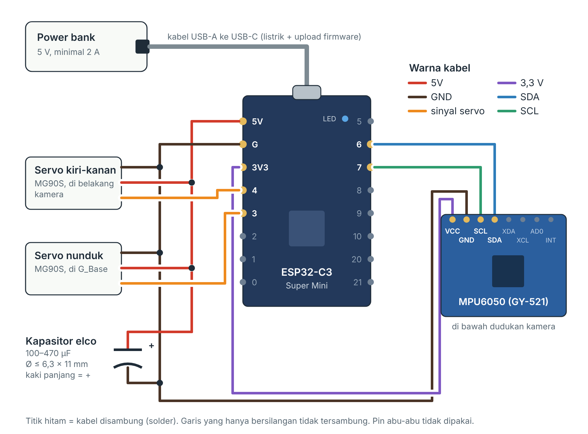

# Gimbal D435 untuk sabuk — panduan singkat

File STL ada di folder `stl`. Model lengkap ada di `fusion/D435_gimbal.f3d`. Firmware ada di `firmware`, aplikasi pengatur ada di `docs` (dibuka lewat browser).

## Prinsip desain
- **Semua kabel cukup ditaruh, lalu ditutup.** Tidak ada kabel yang harus dimasukkan ke lubang tertutup.
  - Kabel servo nunduk masuk alur di atas pelat.
  - Kabel servo kiri-kanan dan IMU diletakkan ke celah tabung poros kanan, lalu ditutup G_PivotCap.
  - Semua kabel masuk ke kotak ESP32 lewat celah samping, lalu ditutup G_EspCover.
- **Elektronik bisa disolder lebih dulu**, misalnya diuji di meja sebelum hasil print datang. Setelah print datang, servo, IMU, dan ESP32 yang sudah tersambung tinggal dipindah dan kabelnya diletakkan ke alurnya. Tidak ada yang perlu dilepas.
- **Semua penutup digeser searah kabel** atau terbuka di sisi kabel, jadi tidak tersangkut kabel. Ini sudah dicek di Fusion.

## Yang perlu dibeli
- 2× servo MG90S **180°** (metal gear). Horn dan sekrup kecilnya sudah ikut dalam paket. Jangan beli versi 360° (continuous), karena tidak bisa diam di satu sudut.
- 1× MPU6050 (modul GY-521, ±21 × 16 mm, 2 lubang M3).
- 1× ESP32-C3 Super Mini.
- 1× kapasitor elektrolit (elco) **100–470 µF**, tegangan berapa pun ≥ 6,3 V, badan maksimal **Ø6,3 × 11 mm** supaya muat di kotak ESP32. Contoh yang pas: 100 µF 25V. Yang 470 µF 50V atau 1000 µF biasanya terlalu besar.
- **Tidak perlu breakout USB-C dan tidak perlu resistor.** Kabel listrik dicolok langsung ke port USB-C milik ESP32-C3.
- **Power bank** 5 V ≥ 2 A + kabel **USB-A ke USB-C**. Pilih yang punya mode arus kecil supaya tidak mati sendiri.
- Kepala colokan USB-C kabel listrik maksimal 14 × 8 mm (kabel biasa ±12 × 7 mm sudah pas).
- Kabel USB-C ke D435 yang tipis dan lentur (Ø4–5 mm).
- Sekrup self-tapping M2: **2 buah M2 × 6** (horn servo nunduk) dan **2 buah M2 × 4** (horn servo kiri-kanan, jangan lebih panjang).
- Kabel untuk IMU: kabel jumper **female-male 20 cm** (kepalanya digunting) atau kabel silikon serabut 28 AWG, 4 warna. Jangan kabel tunggal (solid), karena kabel IMU ikut tertekuk terus di sambungan yang bergerak.
- Heat shrink dan sedikit vaselin/gemuk silikon untuk poros.
- Opsional: 2 kabel ties lebar ≤ 4,8 mm.

## Yang dicetak (semua file sudah dalam posisi cetak)

Pembagian pelat dan urutan cetak ada di `stl/RENCANA_CETAK.md`.

| File | Jumlah | Catatan |
|---|---|---|
| G_Base | 1 | Klip sabuk + dudukan servo nunduk + bantalan poros kanan + kotak ESP32 |
| G_PitchFrame | 1 | Rangka servo kiri-kanan, dengan tabung poros berlubang di kanan |
| G_PivotCap | 1 | Tutup bantalan poros kanan (digeser masuk, menutup kabel di tabung) |
| G_CamTray | 1 | Dudukan kamera + penjepit + kantong IMU di bawah |
| G_ImuLid | 1 | Tutup geser kantong IMU |
| G_ThumbScrew | 1 | Baut 1/4" ke lubang tripod kamera |
| G_ClampScrew | 1 | Baut pengencang penjepit kamera |
| G_ClampJaw | 1 | Rahang penjepit kamera |
| G_Nut_M6 | 1 | Mur penjepit kamera |
| G_EspCover | 1 | Penutup kotak ESP32 + saluran kabel ramping dari poros + pengunci kabel kamera di mukanya |
| G_UsbGate | 1 | Baji geser pengunci kabel USB kamera |
| G_CableScrew | 1 | Baut pengunci kepala colokan listrik (dari sisi kanan kotak) |
| G_BeltScrew_1, G_BeltScrew_2 | **2** (2 file) | Baut kenop penjepit sabuk (diputar dari depan) |
| G_BeltPad_1, G_BeltPad_2 | **2** (2 file) | Bantalan penekan sabuk |

Ada 16 file STL di `stl`, dan 1 file = 1 buah, jadi cukup cetak semua file sekali. Semua baut dan mur besar ikut dicetak: G_ThumbScrew, G_ClampScrew + G_Nut_M6, G_BeltScrew ×2, dan G_CableScrew. Yang tetap logam hanya sekrup kecil M2 servo.

Klip sabuk: lidah sisi badan 3 mm, dinding depan 4,5 mm, dan pinggang atas (penyambung keduanya) 6,5 mm dengan sudut dalam diisi 1,2 mm supaya tidak mudah retak. Alur kabel di atasnya hanya 2 mm, jadi pinggangnya tetap tebal. Bagian yang hanya pengisi dibuat berongga supaya hemat filamen: penyangga dan bagian belakang blok servo (terbuka dari bawah), serta lantai depan kotak ESP32. Semua rongga tetap bisa dicetak tanpa support.

Saran: pakai PETG kalau ada, karena klip sabuk lebih awet melentur. Cetak dengan dinding 3–4 perimeter dan infill 25–40 %. Ulir sudah diberi kelonggaran 0,15 mm. Kalau terlalu seret, cetak ulang dulu mur dan bautnya saja.

## Urutan merakit
1. **Tengahkan servo dulu.**
   - Flash firmware, sambungkan servo (sementara atau langsung yang final), lalu kirim `s`. Kedua servo berhenti di tengah (1500 µs).
   - Jangan putar as servo lagi sesudahnya.
2. **Servo nunduk (MG90S kiri).**
   - Masukkan ke kantong blok kiri G_Base dari sisi kanan, lalu pasang 2 sekrup kupingnya.
   - Kabelnya diletakkan ke celah atas blok, lalu ke alur di atas pelat (ada bibir kecil yang menahan), lalu ke alur tegak di depan pelat sampai ke kotak ESP32.
   - Blok punya celah kabel di **kedua** ujung servo, jadi cocok di mana pun kabel servo Anda keluar.
3. **Servo kiri-kanan ke rangka (G_PitchFrame).**
   - Masukkan servo dari depan sampai kupingnya menempel, lalu pasang 2 sekrup kupingnya.
   - Kabelnya diarahkan ke ruang kecil di balik pelat kanan rangka.
   - Kalau kabel servo Anda keluar di ujung dekat as (kiri), lewatkan kabelnya ke belakang rangka, lalu ke bawahnya. Setelah itu masukkan lewat celah bawah yang sama dengan kabel IMU.
   - Pasang horn servo nunduk ke kantong di pelat kiri rangka dengan 2 sekrup **M2 × 6**. Lengan horn menghadap ke atas.
4. **Dudukan kamera (G_CamTray) ke servo kiri-kanan.**
   - Pasang horn ke kantong di belakang dudukan dengan 2 sekrup **M2 × 4**. Jangan pakai M2 × 6 di sini: ujungnya bisa menyentuh punggung kamera.
   - Tekan dudukan ke as servo, lalu kencangkan sekrup tengah lewat lubang di pelat belakang dudukan.
5. **IMU.**
   - **Solder dulu** 4 kabel ke baris pin GY-521 **dari bawah papan** (sisi tanpa chip), tanpa pin header. Kalau modulnya sudah ada header tersolder, potong pinnya rata.
   - Masukkan GY-521 ke kantong di bawah dudukan: chip menghadap ke atas (ke kamera), 2 lubang M3-nya masuk ke 2 pasak, dan baris pin di belakang.
   - Tutup IMU sengaja tidak menutupi baris pin, jadi solderan dan kabelnya bebas. Kabel langsung masuk ke alur di bawah dudukan, menuju tengah (dekat as servo kiri-kanan).
   - Geser G_ImuLid dari depan ke rel di bawah kantong sampai "klik". Sensor terkunci oleh pasak dan tutup, tanpa double tape.
   - Kalau lubang modul Anda tidak pas dengan pasak (beda merek), potong pasaknya. Tutupnya tetap menjepit papan.
6. **Pasang rangka ke G_Base.**
   - Pegang rangka (sudah lengkap dengan servo kiri-kanan dan dudukan kamera) dalam posisi kamera menunduk, digeser ±3,5 mm ke kanan.
   - Turunkan dari atas sampai tabung kanannya masuk ke bantalan terbuka di lengan kanan G_Base.
   - Geser ke kiri sampai horn masuk ke as servo nunduk.
   - Kencangkan sekrup tengah horn. Obeng masuk lewat lubang tabung dari kanan, sebelum kabel dimasukkan.
7. **Kabel lewat poros kanan (cukup diletakkan).**
   - Kabel IMU keluar dari alur di bawah dudukan (dekat as servo kiri-kanan), lalu masuk ke rangka lewat **celah bawah** di samping pelat kanan. Jadi kabelnya lewat bawah dan tidak terlihat.
   - Di dalam rangka, kabel IMU bergabung dengan kabel servo kiri-kanan. Keduanya diletakkan ke **celah tabung** yang menghadap ke atas.
   - Keluarkan ujungnya di sisi kanan tabung.
   - Geser **G_PivotCap** dari kanan ke rel ekor burung di atas bantalan sampai mentok. Tabung dan kabelnya kini tertutup.
8. **Kamera.**
   - Masukkan G_Nut_M6 dari atas ke tiang penjepit di ujung kiri dudukan.
   - Taruh G_ClampJaw di antara dua rel kecil, lalu putar G_ClampScrew dari luar sampai ujung bautnya masuk ke lubang di belakang rahang.
   - Letakkan kamera dengan port USB-C di kanan, lalu kencangkan G_ThumbScrew dari bawah ke lubang tripod (celahnya ±2 mm, jadi pasti ketemu ulir kamera).
   - Putar G_ClampScrew sampai rahang mendorong kamera ke penahan rendah di kanan.
9. **ESP32-C3.**
   - Masukkan ESP32-C3 dari depan kotak, sejajar pelat: **port USB-C di bawah**, sisi komponen menghadap ke depan. Dorong sampai menempel di belakang; port USB-C pas di atas lubang di lantai kotak.
   - Kabel servo nunduk masuk dari belakang di atas papan. Kabel dari poros masuk lewat **celah di sisi kiri kotak**; celah ini terbuka ke depan, jadi kabel cukup diletakkan.
10. **Penutup G_EspCover.**
    - Turunkan dari atas ke alur di depan kotak. Saluran kabelnya terbuka di bawah, jadi turun melewati kabel dari poros tanpa tersangkut.
    - Setelah turun penuh:
      - kotak tertutup rata;
      - kabel dari poros sampai ke kotak tertutup saluran;
      - G_PivotCap tertahan, tidak bisa bergeser keluar.
11. **Kabel listrik.**
    - Colokkan kabel USB-C dari **bawah** kotak sampai masuk ke port ESP32. Kepala colokannya masuk ±9 mm ke lubang dan dikunci baut.
    - Putar G_CableScrew dari **sisi kanan** kotak sampai menekan kepala colokan. Cukup kencang dengan tangan.
    - Kabel ini juga dipakai untuk upload firmware; penutup tidak perlu dilepas.
12. **Kabel USB kamera.**
    - Jepit di klip bulat di bawah ujung kanan dudukan kamera, lalu sisakan lengkungan kendur ±4 cm ke atas.
    - Tekan kabel ke alur tegak di **muka penutup ESP32** (masuk dari atas, keluar di bawah ke arah laptop), lalu turunkan G_UsbGate. Makin ke bawah, makin keras baji menjepit (cocok untuk kabel Ø4–5 mm).
    - Tarikan kabel dari arah laptop berhenti di sini, jadi tidak menarik kamera dan tidak melawan servo.
13. **Cek.** Gerakkan gimbal dengan tangan sampai ujung-ujungnya (nunduk 10–60°, miring ±25°). Harus ringan dan tidak ada kabel yang tertarik.

## Memasang ke sabuk
- **Baut penjepit (cara utama).**
  1. Kendurkan **kedua** kenop G_BeltScrew: satu di kiri (di antara blok servo nunduk dan rangka), satu di kanan (di atas tutup poros).
  2. Masukkan klip dari atas sabuk lalu tekan turun sampai pengait bawah "klik" di bawah tepi sabuk.
  3. Putar kedua kenop **dari depan** sampai bantalan G_BeltPad menekan sabuk ke sisi badan. Cukup kencang dengan tangan.

  Bantalan duduk di ceruk dinding depan, jadi sabuk setebal 1,5–5 mm semuanya bisa dijepit. Tidak perlu ganjal, dan tidak ada yang menonjol ke belakang.
- **Kabel ties (cadangan, di kedua ujung).** Kalau klip sampai retak, kabel ties di ujung-ujung tetap mengikat dudukan ke sabuk.
  - Kiri: lubang atas dan bawah di ujung kiri pelat.
  - Kanan: lubang atas di atas kotak ESP32 dan lubang bawah di bawahnya. Di antara keduanya, kabel ties lewat saluran tegak di dalam kotak, menempel di pelat (dorong saja dari bawah ke atas).
  1. Masukkan kabel ties dari depan lewat lubang atas.
  2. Turunkan di belakang klip (sisi badan).
  3. Masukkan kembali ke depan lewat lubang bawah.
  4. Kunci di depan bawah, lalu tarik kencang.

  Tarikan kabel ties menekan bagian tebal di antara dua lubang, bukan tepi pelat.
- Pakai di tengah depan (sekitar pusar), jangan di samping pinggul. Di samping, gerakan paha saat melangkah paling besar.

## Sekrup servo
Di sisi servo, as servo itu sendiri yang jadi poros gimbal. Yang mengunci:
- **Badan servo:** 2 sekrup M2 lewat kuping servo ke lubang pilot (Ø1,6) di dudukan/rangka.
- **Horn:** horn masuk ke kantongnya, lalu:
  - 2 sekrup lewat lubang horn ke lubang pilot (Ø1,5): **M2 × 6 di servo nunduk, M2 × 4 di servo kiri-kanan**;
  - sekrup tengah bawaan servo dipasang ke as servo. Ini yang mengunci horn supaya tidak lepas dari as.

Totalnya 10 sekrup logam: 4 di kuping servo, 2 sekrup tengah, 4 di horn. Horn juga terbenam 2 mm di kantongnya, jadi gaya putar servo ditahan dinding kantong, bukan oleh sekrup kecil saja.

## Sambungan kabel (disolder, tanpa konektor)
Semua disolder langsung, tanpa colokan: colokan mudah lepas kalau terus bergoyang, dan semua jalur kabel di sini cukup diletakkan. Kabel jumper boleh dipakai asal kepalanya digunting.

Skema yang sama ada di aplikasi, menu **Rangkaian**.

**Letak komponen:**
- **ESP32-C3:** berdiri sejajar pelat di kotak tipis sisi kanan G_Base, port USB-C menghadap ke bawah. Letaknya diam, tepat di samping poros kanan, jadi kabelnya pendek.
- **IMU:** di kantong bawah dudukan kamera. IMU harus ikut bergerak bersama kamera, karena yang dijaga tetap lurus adalah kamera.
- **Servo nunduk:** di blok kiri dudukan. **Servo kiri-kanan:** di rangka, di belakang kamera.

**Jalur kabel:**
- **Servo nunduk:** celah atas blok kiri → alur di atas pelat → alur tegak di depan pelat → masuk kotak ESP32 dari belakang.
- **IMU:** alur di bawah dudukan kamera → keluar dekat as servo kiri-kanan → celah bawah rangka → bergabung dengan kabel servo kiri-kanan.
- **Servo kiri-kanan dan IMU:** celah tabung poros kanan (ditutup G_PivotCap) → saluran ramping di G_EspCover → celah samping kotak ESP32. Karena lewat tepat di sumbu putar, kabelnya hampir tidak tertekuk saat gimbal bergerak.
- **USB kamera:** klip di bawah dudukan → lengkungan kendur → pengunci geser di muka penutup ESP32 → turun ke laptop.
- **Listrik:** dari bawah kotak, langsung ke port USB-C ESP32.

**Panjang kabel kira-kira:** servo nunduk ±15 cm (potong dari kabel bawaan), servo kiri-kanan ±8 cm, IMU ±18 cm.

**Langkah solder:**
1. **Jangan pasang pin header di ESP32-C3.** Solder kabel dari sisi komponen langsung ke lubang pinnya; di balik papan hanya ada celah 1 mm.
2. **Kapasitor (100–470 µF):** solder kakinya langsung ke pin 5V (kaki panjang, +) dan G (kaki pendek, −). Badannya berdiri di depan papan, di sisi kanan.
3. **Servo:** potong colokannya, kupas, lalu solder:
   - merah → 5V
   - coklat → G
   - oranye → GPIO3 (servo nunduk) / GPIO4 (servo kiri-kanan)
4. **IMU (GY-521):**
   - VCC → 3V3
   - GND → G
   - SDA → GPIO6
   - SCL → GPIO7

   Solder dari bawah papan, tanpa header. Di alur bawah dudukan kamera (dalam 1,9 mm) keempat kabel disusun **berjajar**, jangan ditumpuk. Setelah keluar dari dudukan, kabel boleh dipilin.

   Satu pin 5V dan satu pin G cukup untuk semuanya. Kabel merah kedua servo disatukan dulu (sambungan Y, dibungkus heat shrink), lalu satu ujungnya disolder ke 5V. Kabel coklat kedua servo dan GND IMU disatukan dengan cara yang sama ke G.

   GPIO3 dan GPIO4 tertukar, atau IMU terpasang terbalik, tidak masalah. Kalibrasi otomatis di aplikasi mendeteksi dan membetulkannya.
5. Bungkus tiap sambungan dengan heat shrink.

| Pin ESP32-C3 | Ke |
|---|---|
| Port USB-C (bawah kotak) | kabel dari power bank (dikunci G_CableScrew dari kanan), juga untuk upload firmware |
| 5V | merah kedua servo, kapasitor + |
| G | coklat kedua servo, kapasitor −, GND IMU |
| 3V3 | VCC IMU |
| GPIO3 | oranye servo nunduk |
| GPIO4 | oranye servo kiri-kanan |
| GPIO6 / GPIO7 | SDA / SCL IMU |

**Tentang listrik:**
- Pin 5V ESP32-C3 Super Mini mendapat 5 V dari port USB-C-nya, jadi servo ikut mendapat listrik dari kabel yang sama. Arus servo tidak lewat chip ESP32 atau regulator 3,3 V-nya.
- Saat dipakai normal, kedua servo hanya mengoreksi sedikit-sedikit: totalnya sekitar 0,1–0,5 A, dengan lonjakan sesaat sekitar 1 A. Power bank 2 A cukup.
- Di sebagian papan, jalur USB ke pin 5V melewati dioda kecil. Ukur pin 5V ke G dengan multimeter saat dicolok power bank: sekitar 5,0 V berarti langsung, 4,6–4,8 V berarti lewat dioda. Keduanya aman untuk gimbal ini. Firmware membatasi gerak servo supaya tidak pernah macet menekan mentok.
- Pakai kabel **USB-A ke USB-C**. Beberapa papan Super Mini tiruan tidak punya resistor CC, sehingga kabel USB-C ke USB-C dari charger/power bank kadang tidak mengeluarkan listrik. Kabel USB-A ke USB-C selalu jalan.
- Kalau ESP32 restart saat servo bergerak, aplikasi menampilkan **restart karena tegangan turun** di menu Diagnostik. Pastikan kapasitor terpasang dan power bank ≥ 2 A. Port USB laptop hanya kuat 0,5–0,9 A, jadi saat uji servo pakai power bank.
- Tombol BOOT ESP32 ada di dalam kotak. Biasanya tidak perlu. Kalau upload gagal terus, angkat G_EspCover, tarik papan keluar, lalu tahan BOOT sambil mencolok kabel.

## Uji bertahap (supaya tidak malah menambah getar)
1. **Upload firmware** (lihat bagian Firmware), lalu buka aplikasi dan sambungkan.
2. **Pasang horn di posisi tengah.** Pilih mode **Tengah** di aplikasi, baru pasang horn kedua servo sehingga rangka dan kamera lurus. Sisa miring kecil diluruskan di Kalibrasi, bagian *Posisi tengah servo*.
3. **Kalibrasi otomatis.** Dudukan berdiri tegak seperti dipakai, kamera menunduk, jangan disentuh ±10 detik.
4. **Kalibrasi datar.** Taruh waterpass atau HP (aplikasi waterpass) di atas D435, isi angka yang terbaca, lalu simpan.
5. **Coba di tangan.** Miringkan dudukan pelan-pelan: kamera harus tetap di sudut target. Grafik di menu Kontrol menunjukkan sisa selisihnya.
6. **Kalau bergetar atau berayun**, turunkan P atau I di menu PID sedikit demi sedikit, lalu jalankan **Uji respons**. Hasil yang baik: waktu naik di bawah ±400 ms dan lewat target di bawah ±15 %. Kalau servo berdengung saat diam, naikkan *Dead band* ke 0,4–0,5°.
7. **Pakai di sabuk dan coba jalan.** Program depth di komputer bisa membaca baris `T,...` dari USB untuk mengoreksi sisa kemiringan yang tidak sempat dikejar servo.

## Firmware (`firmware/D435_gimbal_ESP32C3/D435_gimbal_ESP32C3.ino`)
**Pengaturan Arduino IDE:**
- Boards Manager: **esp32 by Espressif Systems** versi 3.x.
- Tools → Board: **ESP32C3 Dev Module**.
- Tools → USB CDC On Boot: **Enabled**.
- Partition Scheme bawaan sudah cukup (firmware ±711 KB).
- Tidak perlu library tambahan.

**Aplikasi pengatur** (`docs/index.html`, dibuka di browser):
- Sambungkan lewat **Bluetooth** (Chrome/Edge di Android, Windows, macOS, Linux; di iPhone pakai browser Bluefy) atau **kabel USB** (Chrome/Edge di komputer).
- **Sandi Bluetooth bawaan 123456.** Ganti di menu Perangkat. Sandi tidak pernah dikirim lewat udara: gimbal mengirim angka acak, aplikasi membalas dengan sidik SHA-256 dari angka itu dan sandi. Setelah 5 kali salah, Bluetooth dikunci 30 detik.
- **Tanda sudah tersambung:** status hijau di aplikasi, bunyi dan getar di HP, LED biru ESP32 menyala terus, dan kamera mengangguk kecil sekali.
- **Lupa sandi:** colok kabel USB, sambungkan lewat USB (tidak perlu sandi), lalu ganti sandinya.

**Yang bisa diatur dari aplikasi:**

| Menu | Isi |
|---|---|
| Kontrol | Sudut nunduk (25/30/35/40/45° atau geser 10–60°), kiri-kanan, mode Stabil / Tengah / Manual / Mati, grafik 10 detik |
| Kalibrasi | Kalibrasi otomatis, kalibrasi datar, kalibrasi gyro, posisi tengah servo, pengaturan servo lanjutan |
| PID | P, I, D, dead band, penghalus, kecepatan servo, kepercayaan akselerometer, filter sensor, uji respons + CSV |
| Diagnostik | Status alat, penyebab restart, kejadian, laporan debug, rekam 30 detik, terminal perintah |
| Rangkaian | Skema dan tabel kabel |
| Perangkat | Sandi, nama Bluetooth, mode saat menyala, LED, bunyi |

**PID dan cara kerjanya.** IMU menempel di kamera, jadi yang diukur adalah kamera itu sendiri. MG90S sudah menahan sudut apa pun yang diperintahkan, sehingga PID menentukan **sudut servo**:
- **I** menggeser servo sampai kamera tepat di target, tanpa sisa;
- **P** menambah reaksi langsung;
- **D** memakai kecepatan putar dari gyro untuk meredam goyangan saat jalan.

Nilai bawaan (P 0,6, I 15, D 0,8) diuji di simulasi fisik: berjalan dengan badan miring 10° dan bergoyang ±3° pada 1,8 Hz, goyangan kamera turun dari sekitar ±10° menjadi sekitar ±1,5°.

**Perintah teks** (Serial Monitor 115200 atau menu Terminal di aplikasi). Kirim `HELP` untuk daftar lengkap.

| Perintah | Fungsi |
|---|---|
| `SET pitch 30` | Sudut nunduk 30° (semua pengaturan lain juga lewat `SET`) |
| `MODE stab` / `center` / `manual` / `off` | Pilih mode |
| `CAL auto` / `CAL gyro` / `CAL level 35.0 0` | Kalibrasi |
| `STEP p 5` | Uji respons nunduk 5° |
| `GET` / `STATUS` / `EVLOG` | Lihat pengaturan, status, kejadian |
| `PIN 654321` | Ganti sandi Bluetooth |

**Data sudut untuk komputer:** baris `T,waktu,nunduk,kirikanan,target_nunduk,target_kirikanan,servo_nunduk,servo_kirikanan,laju_nunduk,laju_kirikanan,mode,flags` dikirim 10 kali per detik (atur di menu Perangkat).

## Supaya putaran lancar (penting untuk stabilisasi)
- **Kedua poros harus satu garis.** Poros kiri adalah as servo nunduk, poros kanan adalah tabung rangka (G_PitchFrame) di bantalan G_Base. Keduanya sudah segaris di desain. Jangan memaksa rangka masuk kalau terasa seret; amplas tipis bagian tabung atau bantalannya.
- **Kelonggaran bantalan 0,25 mm.** Setelah dicetak, putar rangka dengan tangan tanpa servo terpasang. Rangka harus jatuh sendiri karena beratnya, tanpa tersangkut.
- **Olesi tipis** tabung dengan vaselin atau gemuk silikon. Jangan pakai oli encer, karena PLA/PETG bisa lengket berdebu.
- **Kabel jangan menahan gerak.** Kabel yang lewat tabung ada tepat di sumbu putar, jadi hampir tidak tertekuk. Lengkungan kabel IMU (dudukan → rangka) dan kabel USB kamera harus kendur.
- **Kamera di tengah dudukan.** Penjepit kamera sudah membuat titik berat dekat sumbu kiri-kanan. Beban servo kecil, jadi gerakannya halus dan tidak bergetar.
- Kalau servo terdengar "berdengung" saat diam, naikkan *Dead band* di menu PID (lihat Uji bertahap).

## Batas gerak (sudah dicek di Fusion)
- Nunduk 10–60° dan miring kiri-kanan ±25°: tidak ada bagian yang bertabrakan, termasuk dengan kotak ESP32 dan kepala colokan listrik.
- Kotak ESP32 menyatu dengan dinding depan klip di sepanjang lebar dan tinggi bidang belakangnya, bukan hanya menempel di ujung pelat.
- **Jalur pemasangan juga sudah dicek:**
  - rangka diturunkan dari atas ke bantalan, tidak menabrak dudukan maupun servo;
  - G_PivotCap digeser masuk, tidak menabrak apa pun dan tidak menjepit kabel;
  - G_EspCover diturunkan 30 mm, tidak menabrak kabel dari poros.
- Saluran kabel, tutup poros, kenop sabuk, dan pengunci kabel kamera sudah dicek tidak tersentuh dudukan kamera di semua posisi gerak.
- Pandangan depth 87 × 58° tidak tertutup di semua posisi itu.
