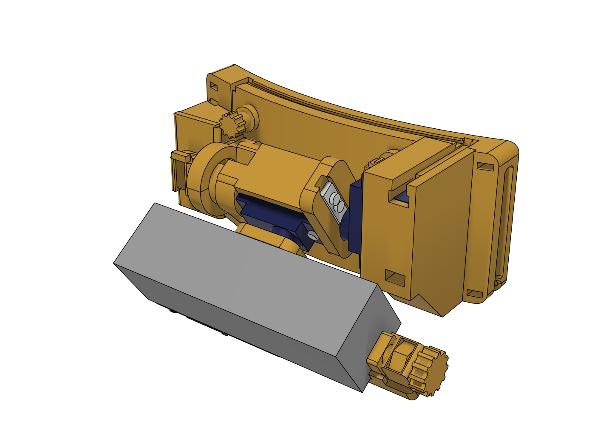
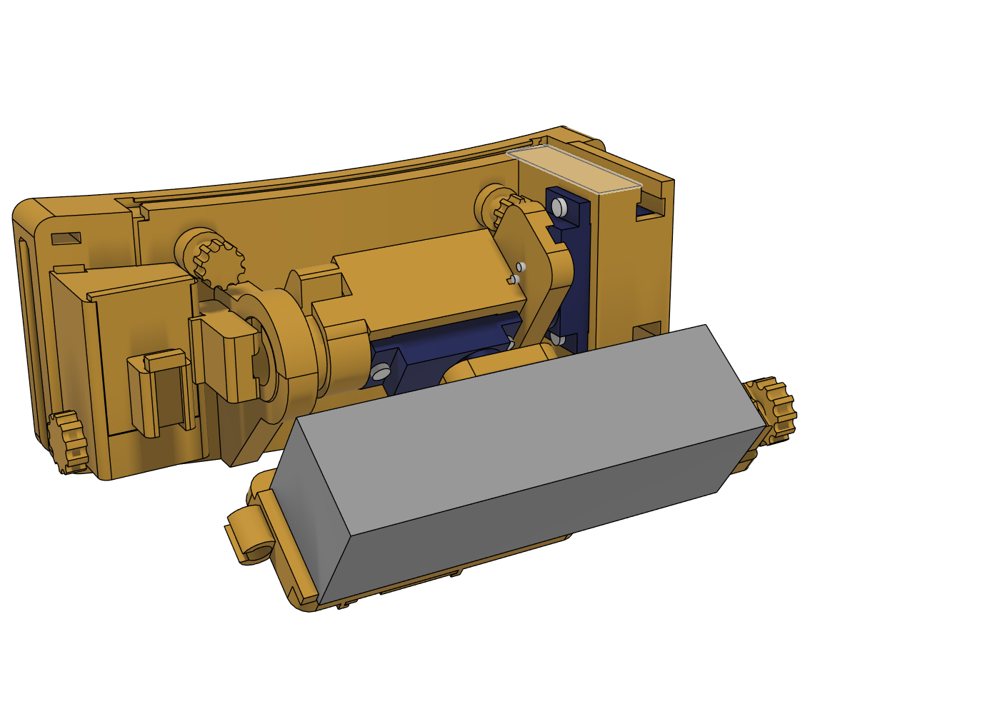
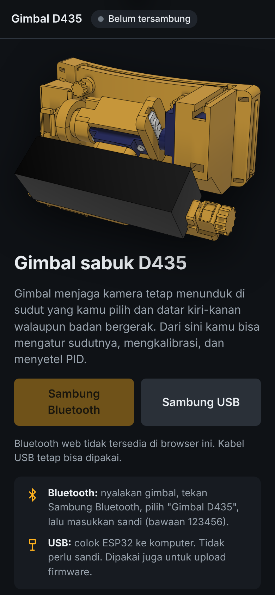
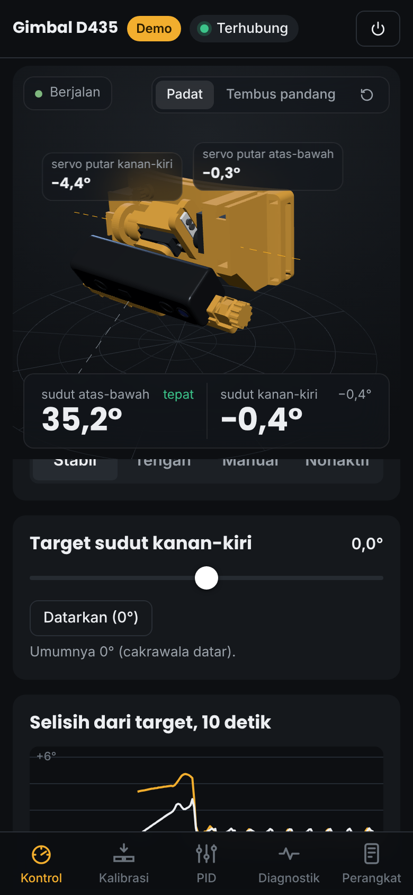
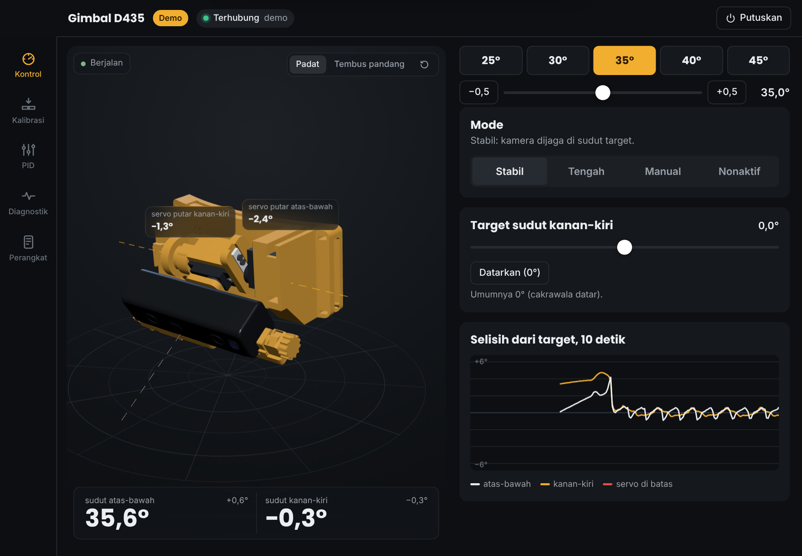
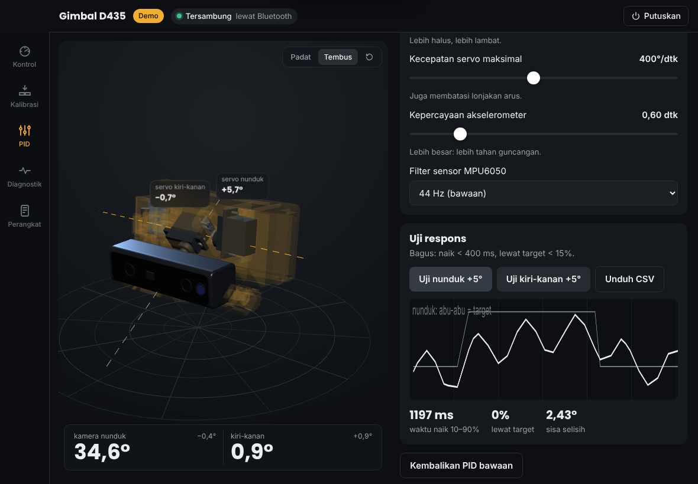
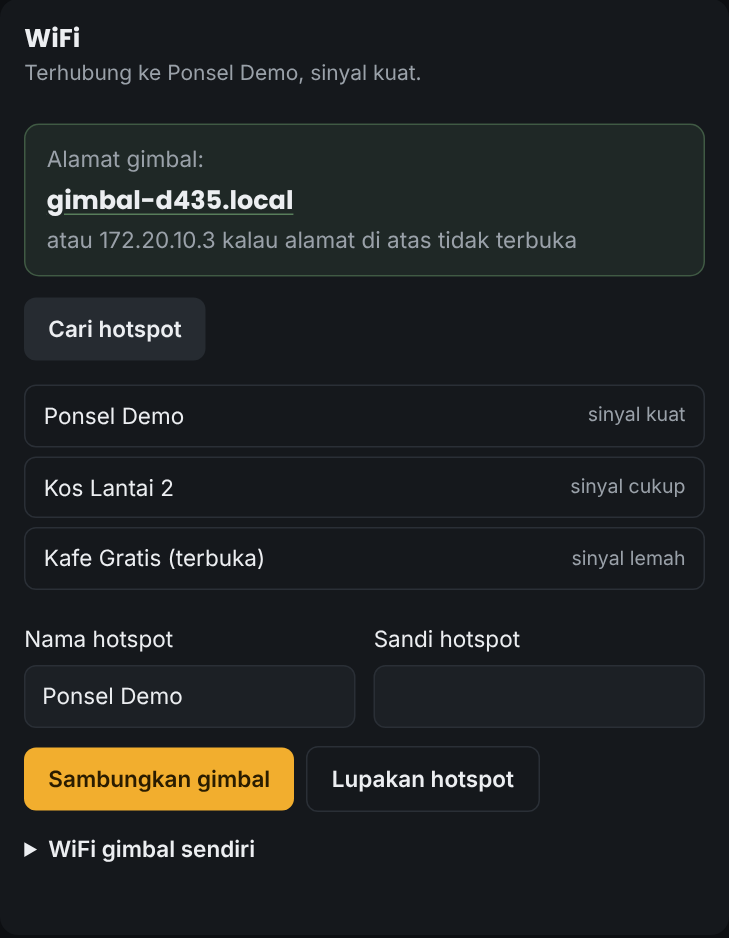
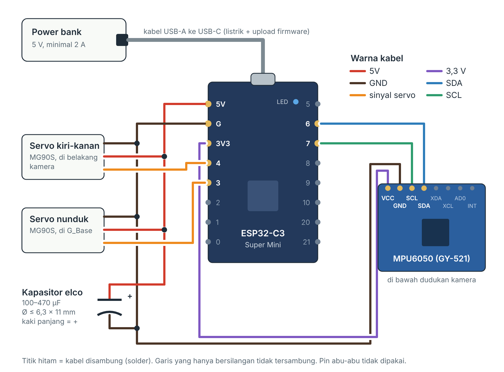
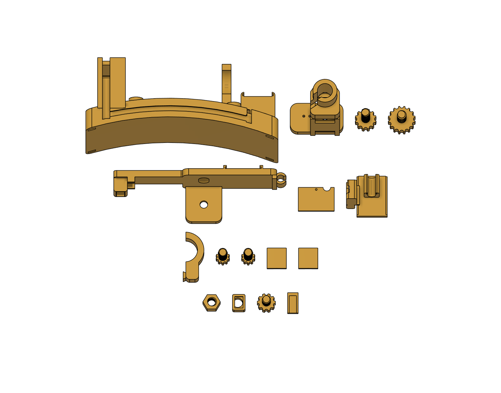

# Stabilizer Camera: a 2-axis belt gimbal for the Intel RealSense D435

[](https://github.com/khaichi11/stabilizer_camera/actions/workflows/firmware.yml)

[Bahasa Indonesia](README.md) | **English**

A belt-worn, 2-axis servo gimbal (pitch + roll) for the Intel RealSense D435. It holds the camera at the down angle you choose (35° by default) and keeps the horizon level while you walk.
- Every part prints without supports, including the large bolts and nuts.
- An ESP32-C3 Super Mini and an MPU6050 run it.
- Everything is set from a web app. The gimbal serves that app itself over WiFi, so it opens in Safari or Chrome, iPad included.

| | |
|---|---|
|  |  |

## What is in the repo

| Folder / file | Contents |
|---|---|
| `stl/` | 16 print-ready STL files (one file = one part) + `RENCANA_CETAK.md` (print plan). `semua_part_satu_pelat.stl` holds every part on one 220 × 220 mm plate |
| `fusion/D435_gimbal.f3d` | Full Fusion 360 model: print layout + preview assembly (servos, camera, cables) |
| `fusion/skrip/` | Fusion Python scripts that build the whole model and run the collision, motion and cable-path checks |
| `firmware/D435_gimbal_ESP32C3/` | ESP32-C3 firmware (Arduino). `web_files.h` is the web app, embedded |
| `firmware/uji_simulasi/` | Physics simulation that tests the real firmware on a computer, without hardware |
| `docs/` | The web app and the wiring diagram (also published on GitHub Pages for the demo) |
| `tools/embed_web.py` | Packs `docs/` into `web_files.h` after the app changes |
| [`GUIDE.en.md`](GUIDE.en.md) / `PANDUAN.md` | Full guide: shopping, printing, assembly, soldering, firmware, calibration |
| `gambar/` | Model renders, diagram, app screenshots |
| `arsip/` | Early design (belt mount without gimbal) and old exports |

The app itself is in Indonesian. It calls pitch *sudut atas-bawah* and roll *sudut kanan-kiri*; [GUIDE.en.md](GUIDE.en.md) lists the menu names in English.

## The control app

**Connecting over WiFi (phone or iPad):**
1. Turn on your phone's hotspot, then power the gimbal. It joins the hotspot it knows on its own.
2. On the phone, or an iPad on that hotspot, open **http://gimbal-d435.local** in Safari or Chrome.
3. Enter the PIN (default `123456`).

**The first time**, the gimbal does not know your hotspot yet, so it starts its own WiFi:
1. Join **Gimbal-D435-xxxx** (password `gimbald435`).
2. Open **http://192.168.4.1**.
3. Go to **Perangkat → WiFi** (Device → WiFi), tap *Cari hotspot* (scan), pick your phone's hotspot and type its password.

The app then shows the gimbal's new address, and the gimbal's own WiFi turns itself off. If the hotspot is missing for 20 s later on, the gimbal's own WiFi comes back.

Good to know:
- The phone keeps its mobile data, because the gimbal joins the hotspot, not the other way round.
- If `.local` does not open (some Android phones), use the IP address shown in the Device menu.
- Several phones/iPads can be connected at once. They all see the same data, and the app tells you when another device is connected.
- USB from a computer (Chrome/Edge) and the **demo mode** are still at **https://khaichi11.github.io/stabilizer_camera/**.

| Start screen | Phone |
|---|---|
|  |  |

| iPad / laptop | X-ray view + step response |
|---|---|
|  |  |

The main screen is a **3D digital twin**: the Fusion model of the gimbal, moving with the sensor data.
- The body and belt clip tilt like your body.
- The frame and camera tray turn by the servo correction.
- The camera stays at the target angle.
- Small tags on each servo show its angle.
- **Tembus pandang** (x-ray) makes the printed parts transparent.
- A **Berjalan** (walking) tag shows when steps are detected.

What you can set:
- Pitch 25/30/35/40/45° or any value 10–60°, roll, and the modes Stabil / Tengah / Manual / Nonaktif (Stabilise / Centre / Manual / Off).
- Auto calibration: IMU orientation, swapped servo cables, direction, scale and speed of each servo.
- Level calibration with a spirit level or a phone level app, so the camera is truly level.
- PID, body feed-forward, prediction, servo dead band, servo pulse rate, sensor filter, and a step-response test with chart and CSV.
- WiFi: scan and pick a hotspot, see the gimbal's address, set the password of the gimbal's own WiFi.
- Diagnostics: reset reason (including brown-outs), IMU status, event log, debug report, 30 s recording, command terminal.
- App PIN (default `123456`). The PIN is never sent: a random challenge + SHA-256 is used, and the connection is locked for 30 s after 5 wrong tries.



## How it stabilises

The IMU sits under the camera, so it measures the camera itself. Four parts work together:

1. **An angle estimate that survives walking.** Gravity is tracked as a vector. The gyro turns it every 5 ms, and the accelerometer pulls it back slowly. When steps are detected, the accelerometer is trusted less but evenly, so the forward/back push of each step does not read as a tilt.
2. **Body feed-forward.** Body motion = camera angle minus the servo position from a servo model. The servo is turned against that motion right away, predicted ahead to cover the servo's delay, instead of waiting for the camera to tilt first.
3. **PID** cleans up the rest (servo scale, horn, load) and holds the camera exactly on target.
4. **Smooth servos.**
   - Servo pulses go out 100 times per second (not 50), so the servos move in small steps and add no fast shake (jello in video).
   - The servo model knows the servo's dead band, so the servos are not pushed back and forth and do not hum.

Results in the physics simulation (realistic walking at the belt: side sway every stride, a nod every step, heel strikes):

| | No gimbal | Old firmware | Now |
|---|---|---|---|
| Pitch error left (RMS) | 6.2° | 2.5° | **0.4°** |
| Roll error left (RMS) | 9.5° | 1.0° | **0.2–0.3°** |
| Fast shake above 5 Hz, pitch | 12.7 °/s | – | **14–17 °/s** |
| Camera within 1° of a new target (5° step) | – | – | **65 ms** |

One limit of the design: a 2-axis gimbal cannot cancel the camera turning left/right when your hips rotate.

## Shopping list

- 2× **MG90S 180°** servo (metal gear), not the 360° version
- 1× **MPU6050** (GY-521 module)
- 1× **ESP32-C3 Super Mini**
- 1× electrolytic capacitor **100–470 µF**, body at most Ø6.3 × 11 mm (for example 100 µF 25 V)
- Power bank 5 V ≥ 2 A + USB-A to USB-C cable
- Thin USB-C cable for the D435
- Self-tapping screws 2× M2 × 6 and 2× M2 × 4
- 20 cm female-male jumper wires (cut the plugs off) or 28 AWG silicone wire, heat shrink
- Optional: 2 cable ties ≤ 4.8 mm

No resistors, battery or power module needed.

## Wiring



| ESP32-C3 pin | To |
|---|---|
| 5V | red of both servos + capacitor (+) |
| G | brown of both servos + IMU GND + capacitor (−) |
| 3V3 | IMU VCC |
| GPIO3 | pitch servo signal |
| GPIO4 | roll servo signal |
| GPIO6 / GPIO7 | IMU SDA / SCL |
| USB-C | power bank (also for uploading the firmware) |

## Printing

See `stl/RENCANA_CETAK.md`. In short:

- No supports on any part.
- The M6 and 1/4" threads are modelled with 0.15 mm clearance.
- Test-print G_Nut_M6 + G_BeltScrew_1 first.
- Give G_Base more walls (perimeters): its belt clip carries the load.



## Firmware

1. Arduino IDE → Boards Manager → **esp32 by Espressif Systems**, version 3.x.
2. Board **ESP32C3 Dev Module**, **USB CDC On Boot: Enabled**, **Partition Scheme: Huge APP (3MB No OTA/1MB SPIFFS)**. The large partition is needed because the web app is built into the firmware.
3. Open `firmware/D435_gimbal_ESP32C3/D435_gimbal_ESP32C3.ino` (keep `web_files.h` in the same folder) and upload. No extra libraries.
4. Follow "The first time" above, then run **Kalibrasi otomatis** (auto calibration) and **Kalibrasi datar** (level calibration).

Until it is calibrated, the firmware holds both servos at centre so they cannot swing wildly.

If you change the app in `docs/`, run `python3 tools/embed_web.py` so the firmware gets it too. CI fails if you forget.

Text commands (Serial Monitor 115200 or the app's terminal): `HELP`, `GET`, `STATUS`, `SET <key> <value>`, `MODE stab|center|manual|off`, `CAL auto|gyro|level`, `STEP p 5`, `PIN <new>`, `WIFI`, `WIFI SCAN`.

## Firmware simulation

GitHub Actions tests every push (badge above):
- the firmware is compiled with the Arduino CLI and the real ESP32 core;
- the embedded app is checked against `docs/`;
- the physics simulation runs, plus summaries for slower servos, a large dead band, gear backlash and a steeper/more lopsided flight of stairs.

The simulation runs the real firmware on a computer against a physics model of:
- two servos that only read a pulse every 10–20 ms, with dead band, delay, top speed and backlash;
- an MPU6050 with its internal filter, mounted upside down and slightly crooked, with gyro bias;
- swapped servo cables;
- a body walking on the flat, up stairs (the right leg lifting higher than the left), at a brisk pace, and with an uneven (limping) gait;
- a pretend phone/iPad opening the app over WiFi.

```
cd firmware/uji_simulasi
g++ -std=gnu++17 -O2 -I mock -include array sim.cpp -o sim && ./sim
```

What it checks (all pass):
- auto calibration (IMU axes, swapped cables, direction, scale and speed of the servos);
- after level calibration the camera sits at 35.0° / 0.0° within 0.25°;
- error while walking < 0.8° RMS;
- the servos add little fast shake;
- quiet servos at rest;
- fast step response without much overshoot;
- the app is served complete (gzip, ETag);
- WebSocket, PIN and the 5-try lockout, two devices at once, a stalled device not slowing the gimbal;
- moving to the hotspot and back to its own WiFi;
- the IMU dropping out and coming back;
- settings kept across reboots, including settings saved by firmware 4.0 surviving the update.

## Fusion model

`fusion/skrip/D435_gimbal.py` is `sumber/geom.py` + `sumber/checks.py` + `sumber/stage2.py` joined together. Run it in Fusion (Utilities → Scripts) to rebuild the model. The same script:
- exports the STLs to `print_ready`;
- writes `build_log.txt` with the fit checks, 55 motion poses, the assembly paths and the routes of all five cables.

The full build guide is in [GUIDE.en.md](GUIDE.en.md).
