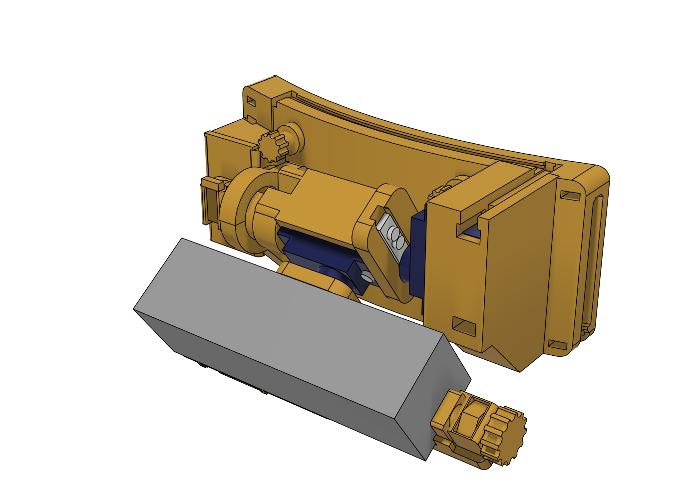
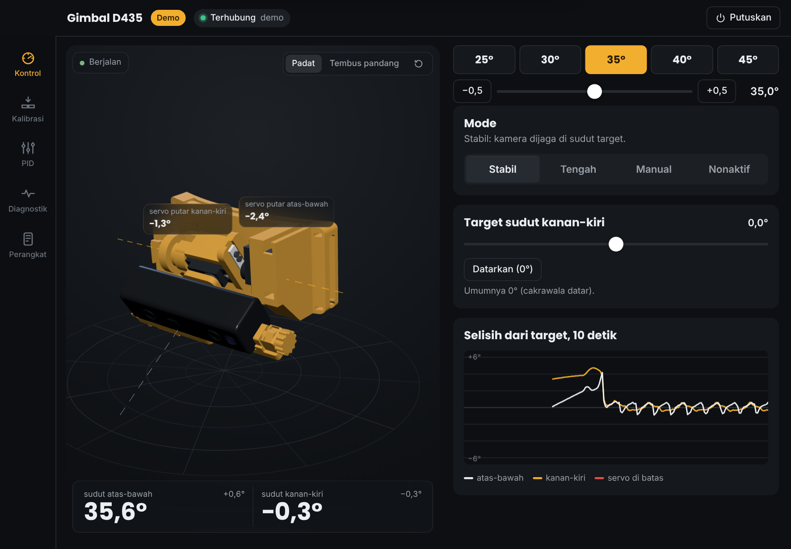

# Stabilizer Camera: gimbal sabuk dua sumbu untuk Intel RealSense D435

[](https://github.com/khaichi11/stabilizer_camera/actions/workflows/firmware.yml)

**Bahasa Indonesia** | [English](README.en.md)

Gimbal servo dua sumbu yang dipasang pada sabuk untuk kamera Intel RealSense D435. Gimbal ini menjaga dua hal saat Anda berjalan:
- **sudut atas-bawah** (*pitch*) kamera tetap pada nilai yang Anda pilih, bawaan 35° di bawah garis datar;
- **sudut kanan-kiri** (*roll*) tetap 0°, sehingga cakrawala tetap datar.

Ciri utamanya:
- Seluruh bagian dicetak 3D tanpa penyangga (*support*), termasuk baut dan mur berukuran besar.
- Pengendalinya ESP32-C3 Super Mini dengan sensor MPU6050.
- Semua pengaturan dilakukan melalui aplikasi web yang disajikan oleh gimbal itu sendiri lewat WiFi, sehingga dapat dibuka di Safari atau Chrome, termasuk pada iPad.

| | |
|---|---|
|  |  |

## Isi repositori

| Folder / berkas | Isi |
|---|---|
| `stl/` | 16 berkas STL siap cetak (satu berkas untuk satu bagian) dan `RENCANA_CETAK.md`. `semua_part_satu_pelat.stl` memuat seluruh bagian dalam satu pelat 220 × 220 mm |
| `fusion/D435_gimbal.f3d` | Model Fusion 360 lengkap: tata letak cetak dan rakitan pratinjau (servo, kamera, kabel) |
| `fusion/skrip/` | Skrip Python Fusion yang membangun seluruh model serta memeriksa tabrakan, rentang gerak, dan jalur kabel |
| `firmware/D435_gimbal_ESP32C3/` | Firmware ESP32-C3 (Arduino). Berkas `web_files.h` berisi aplikasi web yang ikut tertanam |
| `firmware/uji_simulasi/` | Simulasi fisik untuk menguji firmware di komputer tanpa perangkat keras |
| `docs/` | Aplikasi web dan skema rangkaian (juga diterbitkan di GitHub Pages untuk mode demo) |
| `tools/embed_web.py` | Memasukkan isi `docs/` ke `web_files.h` setelah aplikasi diubah |
| `PANDUAN.md` / [`GUIDE.en.md`](GUIDE.en.md) | Panduan lengkap: belanja, pencetakan, perakitan, penyolderan, firmware, dan kalibrasi |
| `gambar/` | Render model, skema, dan tangkapan layar aplikasi |
| `arsip/` | Desain awal (dudukan sabuk tanpa gimbal) dan ekspor lama |

## Aplikasi pengatur

**Menghubungkan lewat WiFi (ponsel atau iPad):**
1. Aktifkan hotspot ponsel, lalu nyalakan gimbal. Gimbal akan terhubung sendiri ke hotspot yang sudah dikenalnya.
2. Pada ponsel atau iPad yang terhubung ke hotspot tersebut, buka **http://gimbal-d435.local** di Safari atau Chrome.
3. Masukkan sandi (bawaan `123456`).

**Pada pemakaian pertama**, gimbal belum mengenal hotspot Anda sehingga gimbal memancarkan WiFi sendiri:
1. Hubungkan ponsel ke WiFi **Gimbal-D435-xxxx** (sandi `gimbald435`).
2. Buka **http://192.168.4.1**.
3. Pada menu **Perangkat → WiFi**, tekan *Cari hotspot*, pilih hotspot ponsel Anda, lalu masukkan sandinya.

Setelah itu aplikasi menampilkan alamat baru gimbal, dan WiFi milik gimbal nonaktif dengan sendirinya. Apabila kelak hotspot tidak ditemukan selama 20 detik, WiFi milik gimbal aktif kembali.

Hal-hal yang perlu diketahui:
- Ponsel tetap dapat memakai data seluler, karena gimbal yang bergabung ke hotspot, bukan sebaliknya.
- Jika alamat `.local` tidak dapat dibuka (terjadi pada sebagian ponsel Android), gunakan alamat IP yang tertera di menu Perangkat.
- Beberapa ponsel atau iPad dapat terhubung bersamaan. Semuanya menampilkan data yang sama, dan aplikasi memberi tahu apabila ada perangkat lain yang terhubung.
- Koneksi USB dari komputer (Chrome/Edge) dan **mode demo** tetap tersedia di **https://khaichi11.github.io/stabilizer_camera/**.

| Layar awal | Ponsel |
|---|---|
|  |  |

| iPad / laptop | Tampilan tembus pandang dan uji respons |
|---|---|
|  |  |

Layar utama menampilkan **kembaran digital 3D** (*digital twin*): model gimbal dari Fusion yang bergerak mengikuti data sensor.
- Badan gimbal dan klip sabuk miring mengikuti gerak tubuh Anda.
- Rangka dan dudukan kamera berputar sebesar koreksi servo.
- Kamera tetap berada pada sudut target.
- Label kecil pada setiap servo menunjukkan sudutnya.
- Tampilan **Tembus pandang** membuat bagian cetak transparan.
- Tanda **Berjalan** muncul ketika langkah kaki terdeteksi.

Yang dapat diatur:
- Sudut atas-bawah 25/30/35/40/45° atau nilai bebas 10–60°, sudut kanan-kiri, serta mode Stabil, Tengah, Manual, dan Nonaktif.
- Servo diatur sendiri (tanpa kalibrasi servo): arah, kabel, skala, batas gerak, dan kecepatan. Bawaan pelan (60°/s), dengan peringatan di atas 200°/s.
- Samakan model 3D (digital twin) dengan gimbal Anda tanpa menggerakkan servo.
- Kalibrasi datar dengan waterpass atau aplikasi waterpass di ponsel, agar kamera benar-benar lurus.
- PID, peredaman gerak badan, prediksi, zona mati servo, frekuensi denyut servo, filter sensor, dan uji respons lengkap dengan grafik dan CSV.
- WiFi: pencarian dan pemilihan hotspot, alamat gimbal, serta sandi WiFi milik gimbal.
- Diagnostik: penyebab mulai ulang (termasuk tegangan turun), status IMU, log kejadian, laporan debug, perekaman 30 detik, dan terminal perintah.
- Sandi aplikasi (bawaan `123456`). Sandi tidak pernah dikirim: aplikasi menjawab tantangan acak dengan SHA-256, dan koneksi dikunci 30 detik setelah lima kali salah.


## Cara kerja stabilisasi

IMU terpasang di bawah kamera, sehingga yang diukur adalah orientasi kamera itu sendiri. Empat bagian bekerja bersama:

1. **Pembacaan sudut yang tahan terhadap langkah kaki.** Arah gravitasi dihitung sebagai vektor. Gyro memutar vektor itu setiap 5 ms, sedangkan akselerometer mengoreksinya secara perlahan. Ketika langkah kaki terdeteksi, akselerometer diberi bobot lebih kecil tetapi merata, sehingga dorongan maju-mundur pada setiap langkah tidak terbaca sebagai kemiringan.
2. **Peredaman gerak badan (umpan maju).** Gerak badan dihitung sebagai sudut kamera dikurangi posisi servo menurut model servo. Servo langsung diperintah untuk melawan gerak tersebut, ditambah prediksi untuk menutupi jeda servo. Dengan demikian, servo tidak perlu menunggu kamera ikut miring.
3. **PID** mengoreksi sisanya (skala servo, posisi horn, beban) dan menjaga kamera tepat pada target.
4. **Gerak servo yang halus.**
   - Denyut perintah servo dikirim 100 kali per detik (bukan 50), sehingga gerak servo tidak patah-patah dan tidak menambah getaran cepat (efek *jello* pada video).
   - Model servo memperhitungkan zona mati servo, sehingga servo tidak dipaksa bergerak bolak-balik dan tidak berdengung.

Hasil simulasi fisik, dengan pola jalan realistis pada sabuk (ayunan kanan-kiri setiap dua langkah, ayunan atas-bawah setiap langkah, dan hentakan tumit):

| | Tanpa gimbal | Firmware lama | Sekarang |
|---|---|---|---|
| Sisa guncangan atas-bawah (RMS) | 6,2° | 2,5° | **0,4°** |
| Sisa guncangan kanan-kiri (RMS) | 9,5° | 1,0° | **0,2–0,3°** |
| Getaran cepat di atas 5 Hz, atas-bawah | 12,7 °/s | – | **14–17 °/s** |
| Waktu hingga kamera berada dalam 1° dari target baru (uji 5°) | – | – | **65 ms** |

Keterbatasan desain: gimbal dua sumbu tidak dapat meredam putaran mendatar (*yaw*) kamera yang terjadi ketika pinggang berputar.

## Daftar belanja

- 2× servo **MG90S 180°** (gigi logam), bukan versi 360°
- 1× **MPU6050** (modul GY-521)
- 1× **ESP32-C3 Super Mini**
- 1× kapasitor elektrolit **100–470 µF** dengan badan maksimal Ø6,3 × 11 mm (misalnya 100 µF 25 V)
- Power bank 5 V ≥ 2 A dan kabel USB-A ke USB-C
- Kabel USB-C tipis untuk D435
- Sekrup *self-tapping* 2× M2 × 6 dan 2× M2 × 4
- Kabel jumper *female-male* 20 cm (kepalanya dipotong) atau kabel silikon 28 AWG, serta selongsong bakar (*heat shrink*)
- Opsional: 2 kabel ties dengan lebar ≤ 4,8 mm

Resistor, baterai, dan modul daya tidak diperlukan.

## Rangkaian


| Pin ESP32-C3 | Tersambung ke |
|---|---|
| 5V | kabel merah kedua servo dan kaki positif kapasitor |
| G | kabel cokelat kedua servo, GND IMU, dan kaki negatif kapasitor |
| 3V3 | VCC IMU |
| GPIO3 | sinyal servo putar atas-bawah |
| GPIO4 | sinyal servo putar kanan-kiri |
| GPIO6 / GPIO7 | SDA / SCL IMU |
| USB-C | power bank (juga untuk mengunggah firmware) |

## Pencetakan

Lihat `stl/RENCANA_CETAK.md`. Ringkasnya:

- Semua bagian dicetak tanpa penyangga.
- Ulir M6 dan 1/4" sudah dimodelkan dengan kelonggaran 0,15 mm.
- Cetak uji G_Nut_M6 dan G_BeltScrew_1 terlebih dahulu.
- G_Base memerlukan dinding (*perimeter*) lebih banyak karena klip sabuknya menahan beban.


## Firmware

1. Arduino IDE → Boards Manager → **esp32 by Espressif Systems** versi 3.x.
2. Pilih board **ESP32C3 Dev Module**, **USB CDC On Boot: Enabled**, dan **Partition Scheme: Huge APP (3MB No OTA/1MB SPIFFS)**. Partisi besar ini diperlukan karena aplikasi web ikut tertanam di dalam firmware.
3. Buka `firmware/D435_gimbal_ESP32C3/D435_gimbal_ESP32C3.ino` (berkas `web_files.h` harus berada di folder yang sama), lalu unggah. Tidak diperlukan pustaka tambahan.
4. Ikuti langkah pemakaian pertama di atas. Di menu **Kalibrasi**, periksa bagian **Servo** (arah, kabel, µs per derajat), lalu jalankan **kalibrasi datar** dan **Samakan model 3D**.

Setiap kali aplikasi di `docs/` diubah, jalankan `python3 tools/embed_web.py` agar perubahan ikut masuk ke firmware. CI akan gagal apabila langkah ini terlewat.

Perintah teks (Serial Monitor 115200 atau terminal di aplikasi): `HELP`, `GET`, `STATUS`, `SET <kunci> <nilai>`, `MODE stab|center|manual|off`, `CAL gyro|level|twin`, `STEP p 5`, `PIN <baru>`, `WIFI`, `WIFI SCAN`.

## Uji simulasi firmware

Setiap *push* diuji otomatis oleh GitHub Actions (lencana di atas):
- firmware dikompilasi dengan Arduino CLI dan inti ESP32 asli;
- aplikasi yang tertanam diperiksa kesamaannya dengan isi `docs/`;
- simulasi fisik dijalankan, ditambah ringkasan untuk servo yang lebih lambat, zona mati yang besar, gigi yang longgar, dan tangga yang lebih curam/lebih pincang.

Simulasi menjalankan firmware asli di komputer terhadap model fisik yang meliputi:
- dua servo yang hanya membaca denyut setiap 10–20 ms, lengkap dengan zona mati, jeda, kecepatan maksimal, dan kelonggaran gigi;
- MPU6050 dengan filter internalnya, terpasang terbalik dan sedikit miring, dengan bias gyro;
- kabel servo yang tertukar;
- tubuh yang berjalan di jalan datar, menaiki tangga (kaki kanan terangkat lebih tinggi daripada kaki kiri), berjalan cepat, dan berjalan pincang (langkah kiri dan kanan tidak sama);
- ponsel atau iPad tiruan yang membuka aplikasi lewat WiFi.

```
cd firmware/uji_simulasi
g++ -std=gnu++17 -O2 -I mock -include array sim.cpp -o sim && ./sim
```

Aspek yang diperiksa (semuanya lolos):
- pengaturan servo manual (kabel tertukar, IMU terbalik, servo terbalik), kecepatan bawaan 60°/s dan peringatan di atas 200°/s, batas atas-bawah 16° menunduk / 1° mendongak;
- `CAL twin` mencatat posisi tengah kamera dengan selisih ≤ 0,5° tanpa menggerakkan servo;
- setelah kalibrasi datar, kamera berada pada 35,0° / 0,0° dengan selisih ≤ 0,25°;
- sisa guncangan saat berjalan di bawah 0,8° RMS;
- getaran cepat yang ditambahkan servo tetap kecil;
- servo diam tanpa berdengung;
- respons cepat tanpa lonjakan berlebih;
- aplikasi tersaji lengkap (gzip, ETag);
- WebSocket, sandi, penguncian setelah lima kali salah, dua perangkat sekaligus, dan perangkat yang macet tidak memperlambat gimbal;
- perpindahan ke hotspot dan kembali ke WiFi milik gimbal;
- IMU yang terputus lalu terbaca kembali;
- pengaturan tersimpan setelah dinyalakan ulang, termasuk pengaturan dari firmware 4.0 yang tetap terpakai setelah pembaruan.

## Batas servo dan konversi sudut

Mulai firmware 4.4 tidak ada lagi kalibrasi servo otomatis. Kalibrasi itu menggerakkan servo jauh untuk mengukurnya, dan servo atas-bawah yang menahan D435 sampai rusak giginya. Kini arah, kabel, skala, dan kecepatan servo diatur sendiri di menu **Kalibrasi → Servo**.

**Kecepatan servo.** Bawaan 60°/s: pelan dan halus, tetapi guncangan kecil saat berjalan tetap diredam. Di atas 200°/s aplikasi dan gimbal memberi peringatan karena servo cepat panas dan aus. Pada simulasi, batas percepatan justru membuat kamera terlambat dan lebih bergetar, jadi batas percepatan mati secara bawaan (`srvacc 0`).

**Batas atas-bawah.** Bawaan **16° menunduk dan 1° mendongak** (hampir tengah). Di luar itu gigi servo selip. Pengaturannya `limpmax 16` (menunduk) dan `limpmin -1` (mendongak), dibatasi lagi oleh `limp` (±16).

**Arti angka.** Semua sudut di aplikasi (target, slider Manual, batas) memakai satuan yang sama: **positif = menunduk**. Firmware mengubah sudut menjadi lebar denyut servo:

```
denyut (µs) = 1500 + trim + arah × sudut × usdeg
```

`usdeg` adalah µs per derajat (bawaan 10,5; MG90S 180° ≈ 11,1 µs per derajat poros, karena 500–2500 µs = 180°). Jika `usdeg` benar, **1° di aplikasi = 1° putaran kamera**.

| Sudut di aplikasi | usdeg 11,1 (MG90S) | usdeg 33 (contoh hasil kalibrasi lama yang salah) |
|---|---|---|
| 1° mendongak | 11 µs ≈ 1° poros | 33 µs ≈ 3° poros |
| 10° menunduk | 111 µs ≈ 10° poros | 330 µs ≈ 30° poros |
| 16° menunduk | 178 µs ≈ 16° poros | 528 µs ≈ 48° poros |

Jadi angka yang sama bisa berarti putaran servo yang sangat berbeda bila `usdeg` salah. Kotak **Konversi sudut** di menu Kalibrasi menampilkan untuk servo atas-bawah: sudut sekarang, µs dari tengah, dan putaran poros servo. Kotak itu juga mengukur skala sebenarnya:
1. Lakukan **Samakan model 3D** (langkah 3 di menu Kalibrasi) dalam mode Tengah dengan badan tegak.
2. Pilih mode **Manual**, tegakkan badan, lalu geser servo atas-bawah ke 5–15° menunduk.
3. Aplikasi membandingkan putaran kamera (dari IMU) dengan sudut servo. Jika berbeda lebih dari 8%, aplikasi menyarankan `usdeg` yang cocok dan menyediakan tombol **Pakai skala ini**.

**Model 3D (digital twin).** Model 3D dibuat dengan kamera menunduk 35° saat servo di tengah. Tombol **Samakan model 3D** (`CAL twin`) mencatat ke mana kamera gimbal Anda menghadap saat kedua servo di tengah. Caranya: sudut IMU dikurangi sudut servo saat itu, sehingga **servo tidak digerakkan**. Hasilnya disimpan di gimbal (`twinp`, `twinr`). Model 3D lalu memutar horn sebesar selisihnya, sehingga badan, servo, dan kamera di layar sama dengan gimbal Anda.

## Model Fusion

`fusion/skrip/D435_gimbal.py` merupakan gabungan `sumber/geom.py`, `sumber/checks.py`, dan `sumber/stage2.py`. Jalankan skrip tersebut di Fusion (Utilities → Scripts) untuk membangun ulang model. Skrip yang sama:
- mengekspor STL ke `print_ready`;
- menulis `build_log.txt` yang memuat hasil pemeriksaan kecocokan bagian, 55 posisi gerak, jalur pemasangan, dan jalur kelima kabel.

Panduan perakitan lengkap tersedia di [PANDUAN.md](PANDUAN.md).
