# Stabilizer Camera: gimbal sabuk 2 sumbu untuk Intel RealSense D435

Gimbal servo 2 sumbu (nunduk + kiri-kanan) yang dipakai di sabuk, untuk kamera Intel RealSense D435. Kamera dijaga menunduk sekitar 35° dan datar kiri-kanan saat berjalan. Semua bagian dicetak 3D tanpa support, baut dan mur besar ikut dicetak. Kendalinya ESP32-C3 Super Mini + MPU6050, dan semua pengaturannya lewat aplikasi web via Bluetooth (bersandi) atau kabel USB.

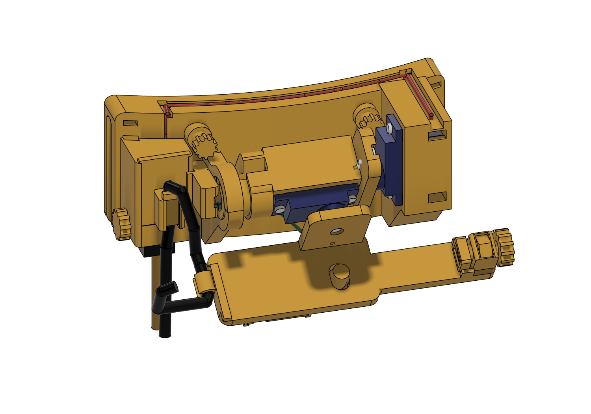

## Isi repo

| Folder / file | Isi |
|---|---|
| `stl/` | 16 file STL siap cetak (1 file = 1 buah) + `RENCANA_CETAK.md`. `semua_part_satu_pelat.stl` berisi semua part dalam satu pelat 220 × 220 mm |
| `fusion/D435_gimbal.f3d` | Model Fusion 360 lengkap: tata letak cetak + rakitan pratinjau (servo, kamera, kabel) |
| `fusion/skrip/` | Skrip Python Fusion yang membangun seluruh model dan menjalankan cek tabrakan, gerak, dan jalur kabel |
| `firmware/D435_gimbal_ESP32C3/` | Firmware ESP32-C3 (Arduino) |
| `firmware/uji_simulasi/` | Simulasi fisik di komputer untuk menguji firmware tanpa alat |
| `docs/` | Aplikasi web pengatur (Bluetooth / USB) dan skema rangkaian |
| `PANDUAN.md` | Panduan lengkap: belanja, cetak, rakit, solder, firmware, kalibrasi |
| `gambar/` | Render model, skema, tangkapan layar aplikasi |
| `arsip/` | Desain awal (dudukan sabuk tanpa gimbal) dan ekspor lama |

## Aplikasi pengatur

Buka **https://khaichi11.github.io/stabilizer_camera/** di Chrome atau Edge (Android, Windows, macOS, Linux). Di iPhone pakai browser Bluefy. Ada mode demo untuk mencoba tanpa alat.

| HP | Komputer |
|---|---|
| 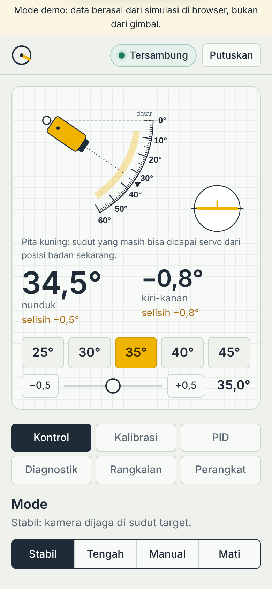 | 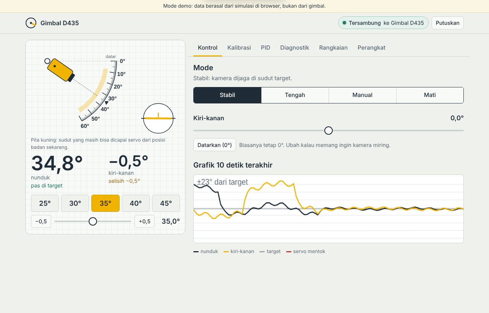 |

- Sudut nunduk 25/30/35/40/45° atau geser 10–60°, kiri-kanan, mode Stabil / Tengah / Manual / Mati.
- Kalibrasi otomatis: mendeteksi arah IMU, kabel servo tertukar, arah dan skala tiap servo.
- Kalibrasi datar memakai waterpass / aplikasi waterpass di HP, supaya benar-benar lurus.
- PID (P, I, D), dead band, penghalus, kecepatan servo, filter sensor, uji respons dengan grafik dan CSV.
- Diagnostik: penyebab restart (termasuk tegangan turun), status IMU, log kejadian, laporan debug, rekam 30 detik, terminal perintah.
- Sandi Bluetooth (bawaan `123456`). Sandi tidak pernah dikirim lewat udara: dipakai tantangan acak + SHA-256, dan Bluetooth dikunci 30 detik setelah 5 kali salah.
- Tanda tersambung: status hijau, bunyi + getar di HP, LED biru ESP32 menyala terus, dan kamera mengangguk kecil.

## Yang perlu dibeli

- 2× servo **MG90S 180°** (metal gear), bukan versi 360°
- 1× **MPU6050** (modul GY-521)
- 1× **ESP32-C3 Super Mini**
- 1× kapasitor elco **100–470 µF**, badan maksimal Ø6,3 × 11 mm (misalnya 100 µF 25V)
- Power bank 5 V ≥ 2 A + kabel USB-A ke USB-C
- Kabel USB-C tipis untuk D435
- Sekrup self-tapping 2× M2 × 6 dan 2× M2 × 4
- Kabel jumper female-male 20 cm (kepalanya digunting) atau kabel silikon 28 AWG, heat shrink
- Opsional: 2 kabel ties ≤ 4,8 mm

Tidak perlu resistor, baterai, atau modul daya.

## Rangkaian

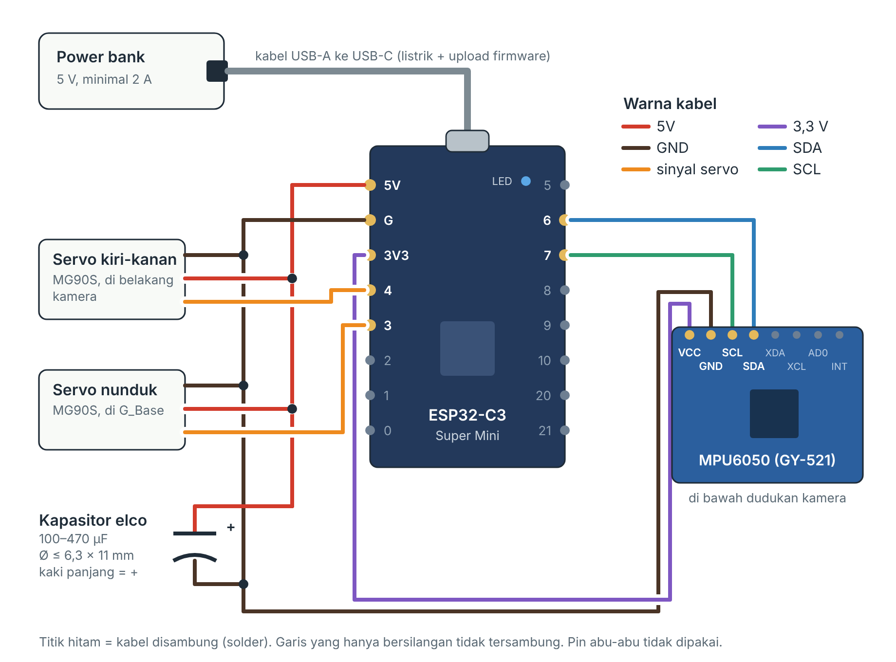

| Pin ESP32-C3 | Ke |
|---|---|
| 5V | merah kedua servo + kapasitor (+) |
| G | coklat kedua servo + GND IMU + kapasitor (−) |
| 3V3 | VCC IMU |
| GPIO3 | sinyal servo nunduk |
| GPIO4 | sinyal servo kiri-kanan |
| GPIO6 / GPIO7 | SDA / SCL IMU |
| USB-C | power bank (juga untuk upload firmware) |

## Cetak

Lihat `stl/RENCANA_CETAK.md`. Ringkasnya:

- Semua part tanpa support.
- Ulir M6 dan 1/4" sudah dimodelkan dengan kelonggaran 0,15 mm.
- Cetak uji G_Nut_M6 + G_BeltScrew_1 dulu.
- G_Base butuh dinding (perimeter) lebih banyak karena klip sabuknya menahan beban.

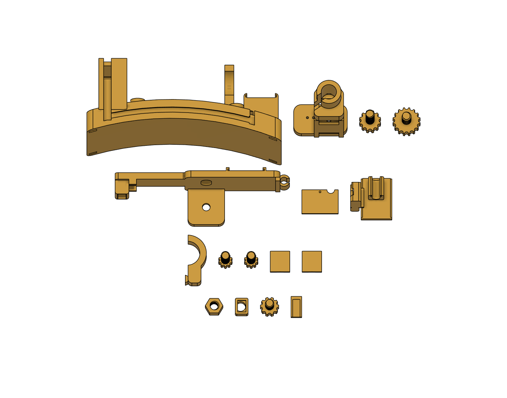

## Firmware

1. Arduino IDE → Boards Manager → **esp32 by Espressif Systems** versi 3.x.
2. Board **ESP32C3 Dev Module**, **USB CDC On Boot: Enabled**, Partition Scheme **Huge APP (3MB No OTA/1MB SPIFFS)**.
3. Buka `firmware/D435_gimbal_ESP32C3/D435_gimbal_ESP32C3.ino`, lalu upload. Tidak perlu library tambahan.
4. Buka aplikasi, sambungkan, lalu jalankan **Kalibrasi otomatis** dan **Kalibrasi datar**.

Sebelum dikalibrasi, servo ditahan di tengah supaya tidak bergerak liar.

Perintah teks (Serial Monitor 115200 atau Terminal di aplikasi): `HELP`, `GET`, `STATUS`, `SET <kunci> <nilai>`, `MODE stab|center|manual|off`, `CAL auto|gyro|level`, `STEP p 5`, `PIN <baru>`.

## Uji simulasi firmware

Firmware asli dijalankan di komputer melawan model fisik: dua servo dengan dead band dan backlash, sensor ber-noise yang terpasang terbalik, kabel servo tertukar, dan badan yang berjalan.

```
cd firmware/uji_simulasi
g++ -std=gnu++17 -O2 -I mock -include array sim.cpp -o sim && ./sim
```

Hasil saat ini: semua cek lolos.
- Kalibrasi otomatis menemukan sumbu IMU, kabel tertukar, dan arah servo.
- Setelah kalibrasi datar, kamera di 35,0° / 0,0° dengan selisih ≤ 0,25°.
- Saat berjalan, goyangan kamera turun dari sekitar ±10° menjadi sekitar ±1,5°.
- Sandi, kunci 5 kali salah, IMU lepas dan tersambung lagi, serta penyimpanan pengaturan juga diuji.

## Model Fusion

`fusion/skrip/D435_gimbal.py` adalah gabungan `sumber/geom.py` + `sumber/checks.py` + `sumber/stage2.py`. Jalankan skrip itu di Fusion (Utilities → Scripts) untuk membangun ulang model. Skrip yang sama:
- mengekspor STL ke `print_ready`;
- menulis `build_log.txt` berisi hasil cek kecocokan part, 55 posisi gerak, jalur pemasangan, dan jalur kelima kabel.

## Galeri

| | |
|---|---|
| 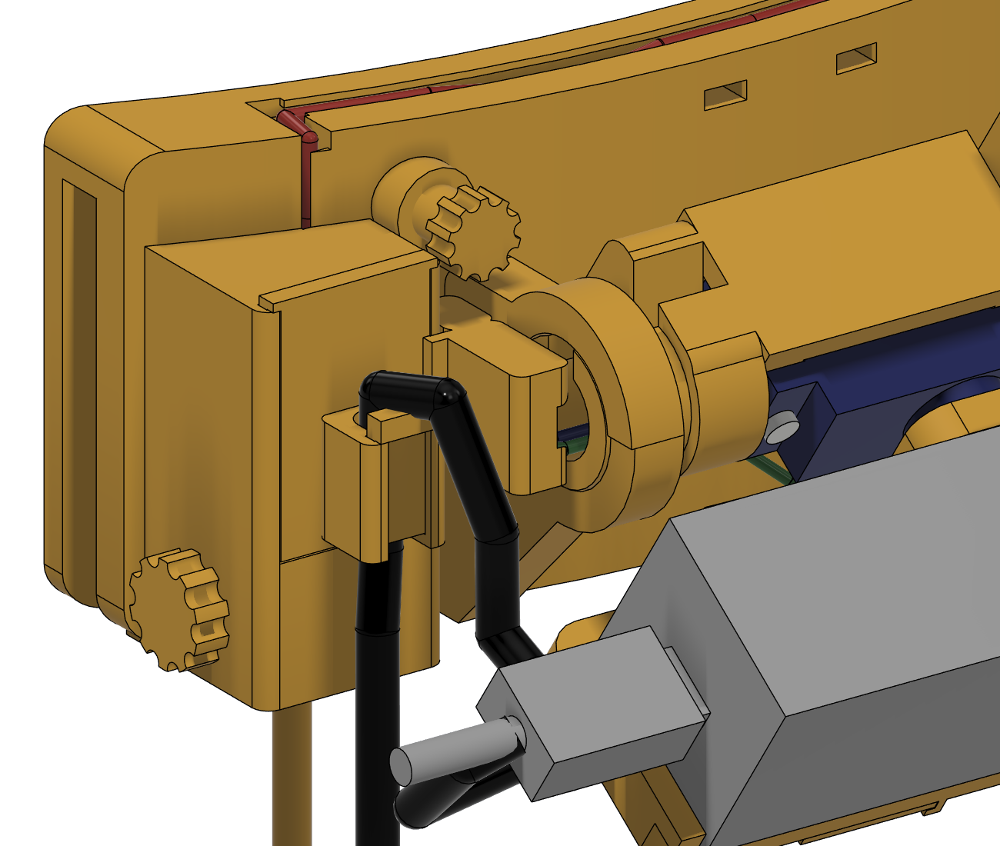 | 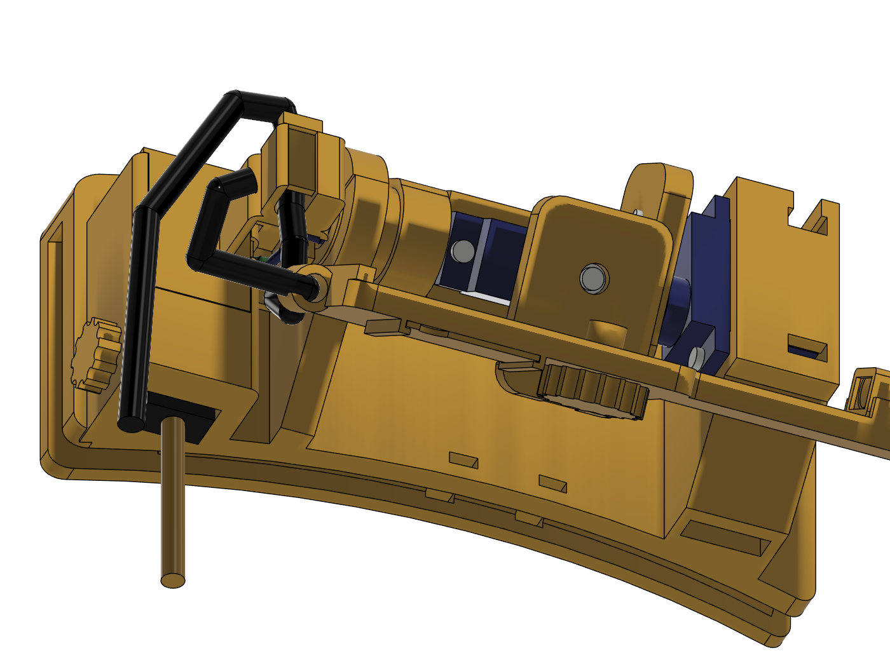 |
| 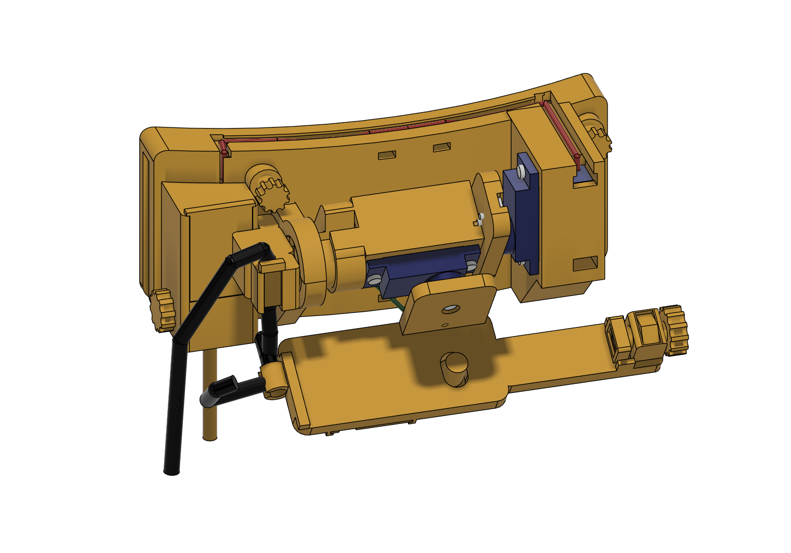 | 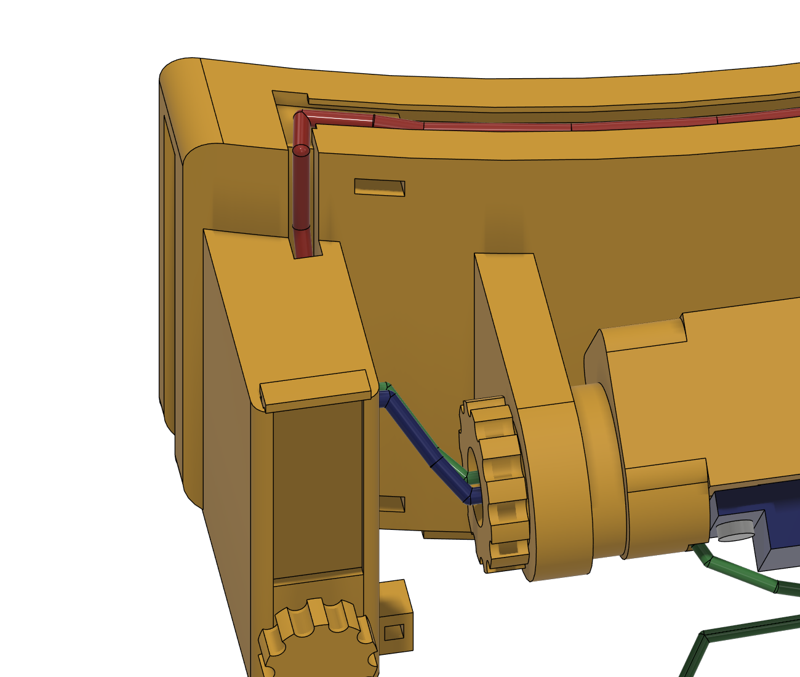 |
| 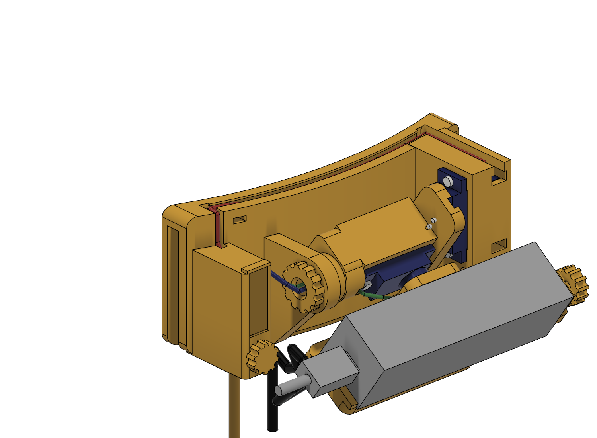 | 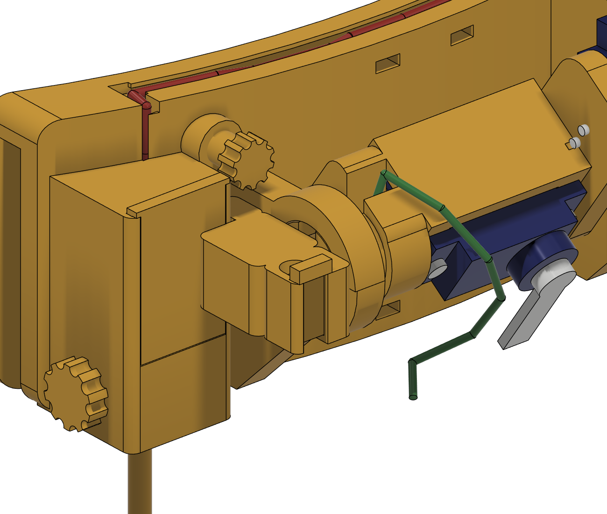 |

Panduan lengkap merakit ada di [PANDUAN.md](PANDUAN.md).
